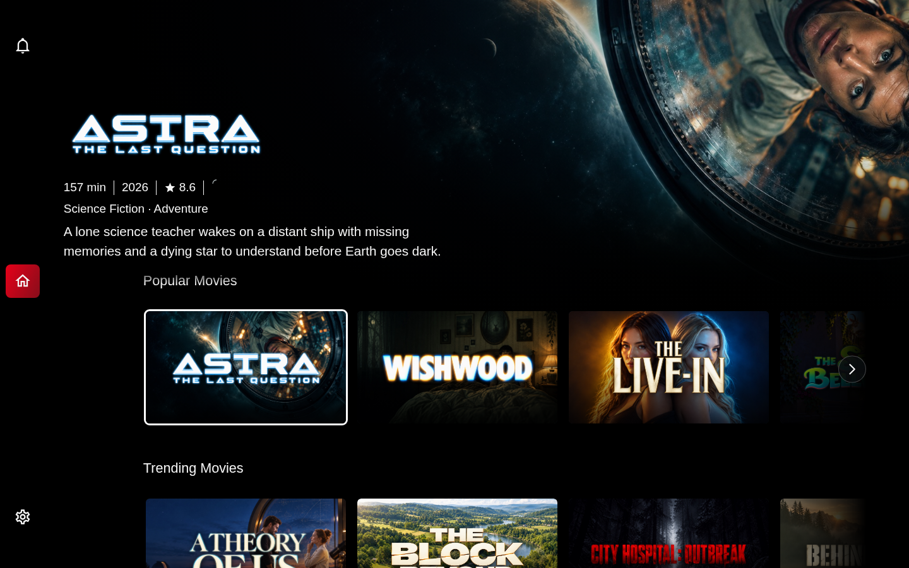
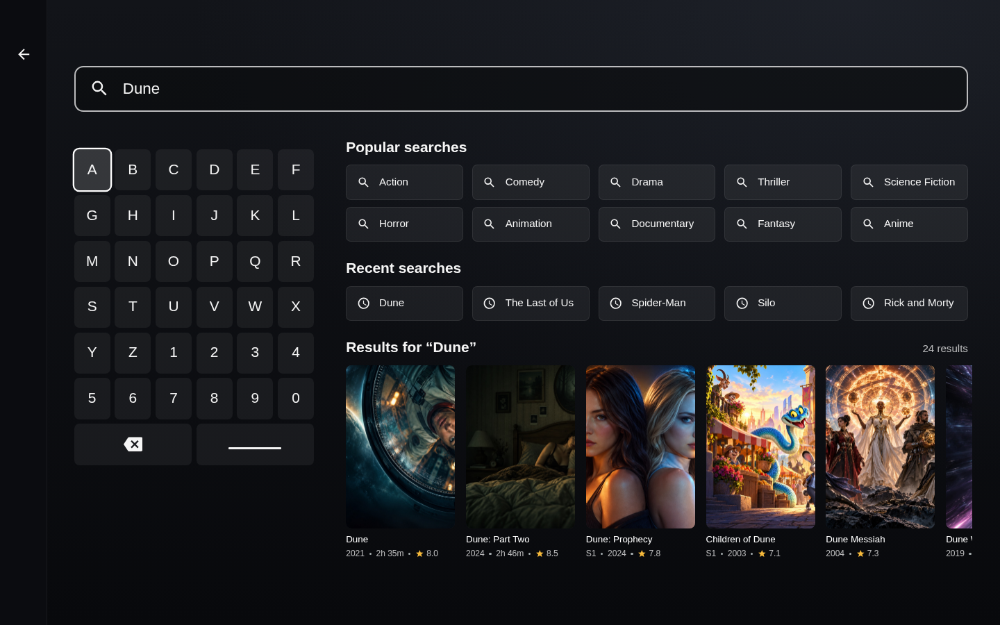
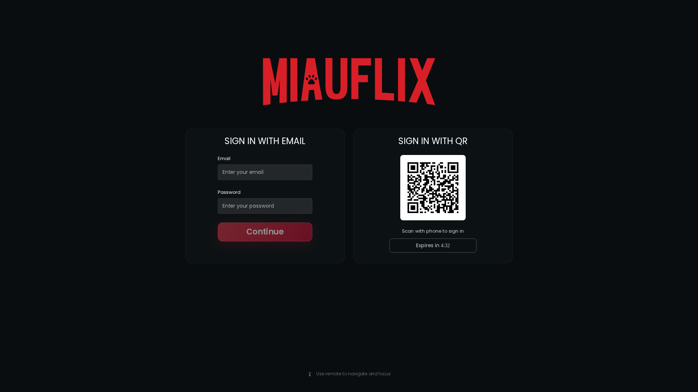
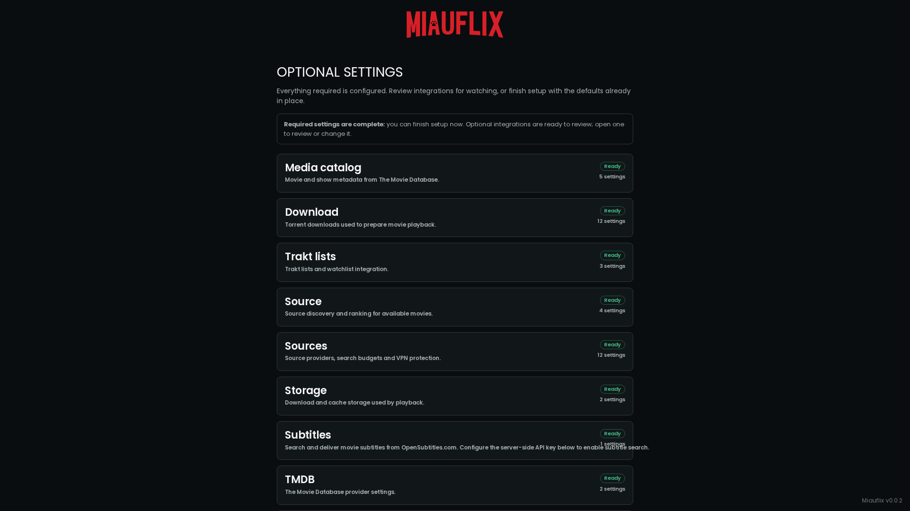

<div align="center">


**The self-hosted streaming service that meows!**

[](LICENSE)
[](https://github.com/maury91/miauflix/actions/workflows/ci.yml)
[](docs/setup/docker-setup.md#prebuilt-images)



</div>

Miauflix is a streaming service you run yourself. Browse movies and TV shows with rich artwork and press **Watch Now**. The server downloads the media through BitTorrent and streams it to your browser or TV, with no media library to manage.

- ⚡ **Prepares playback ahead**: background preloading and media inspection reduce waiting; startup depends on the source, connection, and conversion needed
- 🔎 **Finds sources for you**: searches multiple providers and chooses a source for your device
- 📺 **Made for the couch**: full remote-control navigation, and sign in on a TV by scanning a QR code
- 🔐 **Account and privacy controls**: administrator-created accounts, encrypted downloads and selected sensitive records, and VPN checks
- 🔗 **Personal viewing**: watchlists, ratings, Continue watching, and optional Trakt watchlist and playback sync
- 🐳 **One command to run**: prebuilt images for `amd64` and `arm64`, configured from the browser

See the [Feature Guide](docs/features.md) for grouped explanations, requirements, and current limitations.

## Screenshots

<table>
  <tr>
    <td width="50%"><br><sub><b>Details</b>: pick a movie, Watch Now</sub></td>
    <td width="50%"><br><sub><b>Search</b>: on-screen keyboard, genres and recent searches</sub></td>
  </tr>
  <tr>
    <td width="50%"><br><sub><b>Sign in</b>: with email, or by scanning the QR code with your phone</sub></td>
    <td width="50%"><br><sub><b>Setup</b>: everything is configured from the browser</sub></td>
  </tr>
</table>

## Quick start

You need [Docker](https://docs.docker.com/get-docker/) and a free [TMDB access token](https://developer.themoviedb.org/docs).

**1. Download the Compose file**

```bash
curl -fsSLO https://raw.githubusercontent.com/maury91/miauflix/main/docker-compose.yml
```

**2. Start Miauflix**

```bash
docker compose up -d
```

**3. Open <http://localhost:3000>**, create your admin account and paste your TMDB token. That's it. 🎉

> [!NOTE]
> Until you create the admin account, anyone who can reach Miauflix could create it instead, so the quick start only accepts connections from this computer. Once your account exists, [open it to your local network](docs/setup/docker-setup.md#open-it-to-your-local-network) to watch from your TV or phone.

> [!IMPORTANT]
> Miauflix streams over BitTorrent, so it won't search for sources until it detects a VPN: without one, peers see your real IP. [Add NordVPN](docs/setup/docker-setup.md#using-a-vpn) (a must on a server), or [opt out](docs/setup/docker-setup.md#running-without-a-vpn) if you accept the risk.

## Next steps

- 📺 **Watch from your TV or phone**: [Open it to your local network](docs/setup/docker-setup.md#open-it-to-your-local-network)
- 📺 **Install it on a Samsung TV**: [Samsung TV app](docs/setup/samsung-tv.md)
- 🔒 **Route traffic through a VPN**: [Using a VPN](docs/setup/docker-setup.md#using-a-vpn)
- 🌐 **Put it on a domain with HTTPS**: [Getting Started](docs/setup/getting-started.md) and [HTTPS with a domain](docs/setup/docker-setup.md#https-with-a-domain)
- ⚙️ **Tune every setting**: [Environment Variables](docs/setup/environment-variables.md)
- 🛡️ **Get past Cloudflare-protected sources**: [FlareSolverr](docs/setup/flaresolverr.md)
- 🐱 **Why it works the way it does**: [Philosophy](docs/philosophy.md)
- 📚 **Everything else**: [Documentation](docs/README.md)

## Planned improvements

TV season and episode navigation, subtitles, and Jackett/Prowlarr integration are implemented. The current [task list](ToDo.md) includes:

- A quality picker beside Watch Now
- Correct handling of multiple episodes combined in one video
- Interface translations and language preferences
- Subtitle translation and language-learning tools
- VPN diagnostics and exit-server controls in Settings

See the [Feature Guide](docs/features.md) for how these plans differ from available features. The task list does not promise delivery dates.

## Contributing

Contributions are welcome! Read [CONTRIBUTING.md](CONTRIBUTING.md) to get a development environment running.

## Disclaimer

Miauflix doesn't host or distribute any content. It's a tool for streaming media that you are entitled to access, and you are responsible for complying with the laws of your country.

## License

This project is source available under the [PolyForm Noncommercial License 1.0.0](LICENSE). You may use, modify, and share it for permitted noncommercial purposes. Commercial use requires separate permission from the relevant rights holders. See the license for its full terms, including permitted organizational uses.

This license applies to project-owned code and original materials. Third-party libraries, assets, and catalog artwork retain their own licenses and rights. It does not revoke licenses already granted for earlier versions, including earlier MIT-licensed copies.

<div align="center">
  <sub>Built with 😻 by the Miauflix team</sub>
</div>
