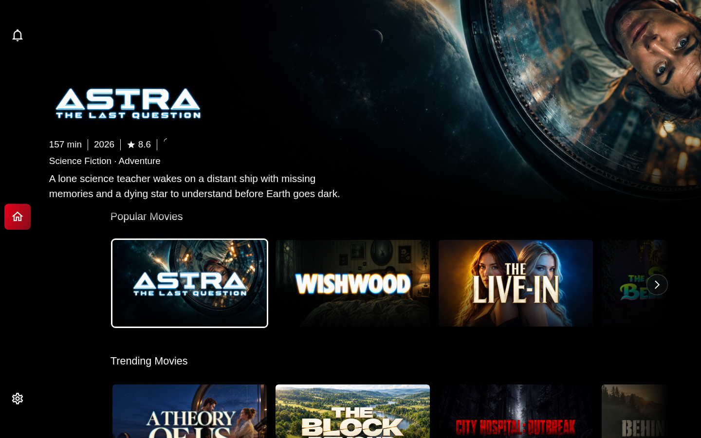
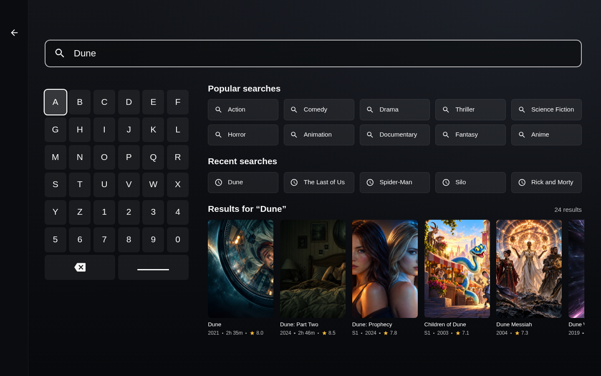
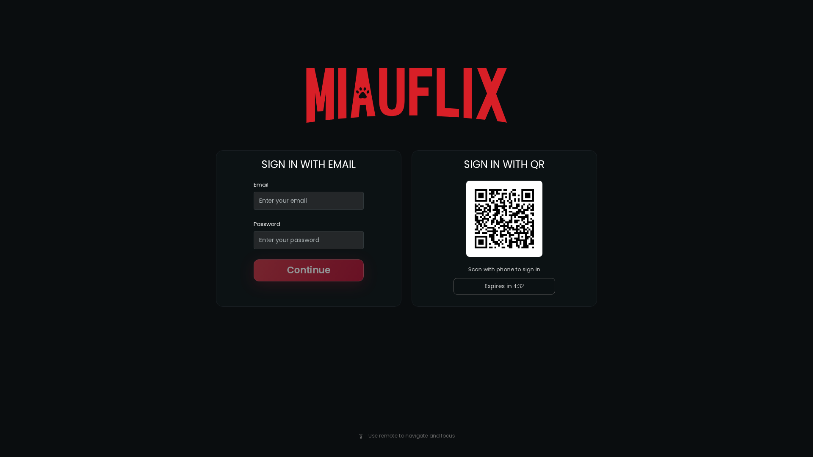
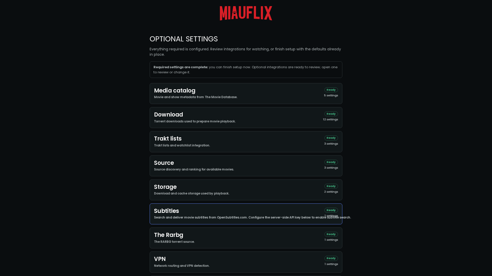

<div align="center">


**The self-hosted streaming service that meows!**

[](https://opensource.org/licenses/MIT)
[](https://github.com/maury91/miauflix/actions/workflows/ci.yml)
[](docs/setup/docker-setup.md#prebuilt-images)



</div>

Miauflix is a streaming service you run yourself. Browse movies with rich artwork, press **Watch Now**, and it streams peer-to-peer straight to your browser or TV, with no media library to manage.

- ⚡ **Starts fast**: background preloading aims for playback in under 2 seconds
- 🔎 **Finds sources for you**: searches several content directories and picks the best quality
- 📺 **Made for the couch**: full remote-control navigation, and sign in on a TV by scanning a QR code
- 🔐 **Private by design**: invite-only accounts, data encrypted at rest, VPN enforcement
- 🔗 **Trakt sync**: your watchlist and lists, kept in sync
- 🐳 **One command to run**: prebuilt images for `amd64` and `arm64`, configured from the browser

## Screenshots

<table>
  <tr>
    <td width="50%"><br><sub><b>Details</b>: pick a movie, Watch Now</sub></td>
    <td width="50%"><br><sub><b>Search</b>: on-screen keyboard, genres and recent searches</sub></td>
  </tr>
  <tr>
    <td width="50%"><br><sub><b>Sign in</b>: with email, or by scanning the QR code with your phone</sub></td>
    <td width="50%"><br><sub><b>Setup</b>: everything is configured from the browser</sub></td>
  </tr>
</table>

## Quick start

You need [Docker](https://docs.docker.com/get-docker/) and a free [TMDB access token](https://developer.themoviedb.org/docs).

**1. Download the Compose file**

```bash
curl -fsSLO https://raw.githubusercontent.com/maury91/miauflix/main/docker-compose.yml
```

**2. Start Miauflix**

```bash
docker compose up -d
```

**3. Open <http://localhost:3000>**, create your admin account and paste your TMDB token. That's it. 🎉

> [!NOTE]
> Until you create the admin account, anyone who can reach Miauflix could create it instead, so the quick start only accepts connections from this computer. Once your account exists, [open it to your local network](docs/setup/docker-setup.md#open-it-to-your-local-network) to watch from your TV or phone.

> [!IMPORTANT]
> Miauflix streams over BitTorrent, so it won't search for sources until it detects a VPN: without one, peers see your real IP. [Add NordVPN](docs/setup/docker-setup.md#using-a-vpn) (a must on a server), or [opt out](docs/setup/docker-setup.md#running-without-a-vpn) if you accept the risk.

## Next steps

- 📺 **Watch from your TV or phone**: [Open it to your local network](docs/setup/docker-setup.md#open-it-to-your-local-network)
- 🔒 **Route traffic through a VPN**: [Using a VPN](docs/setup/docker-setup.md#using-a-vpn)
- 🌐 **Put it on a domain with HTTPS**: [Getting Started](docs/setup/getting-started.md) and [HTTPS with a domain](docs/setup/docker-setup.md#https-with-a-domain)
- ⚙️ **Tune every setting**: [Environment Variables](docs/setup/environment-variables.md)
- 🛡️ **Get past Cloudflare-protected sources**: [FlareSolverr](docs/setup/flaresolverr.md)
- 🐱 **Why it works the way it does**: [Philosophy](docs/philosophy.md)
- 📚 **Everything else**: [Documentation](docs/README.md)

## Roadmap

- 📺 TV shows: episode navigation and season management
- ⛩️ Anime support
- 🎯 More sources: 1337x, Nyaa, Jackett and Prowlarr
- 📱 Native iOS and Android apps

## Contributing

Contributions are welcome! Read [CONTRIBUTING.md](CONTRIBUTING.md) to get a development environment running.

## Disclaimer

Miauflix doesn't host or distribute any content. It's a tool for streaming media that you are entitled to access, and you are responsible for complying with the laws of your country.

## License

[MIT](LICENSE)

<div align="center">
  <sub>Built with 😻 by the Miauflix team</sub>
</div>
