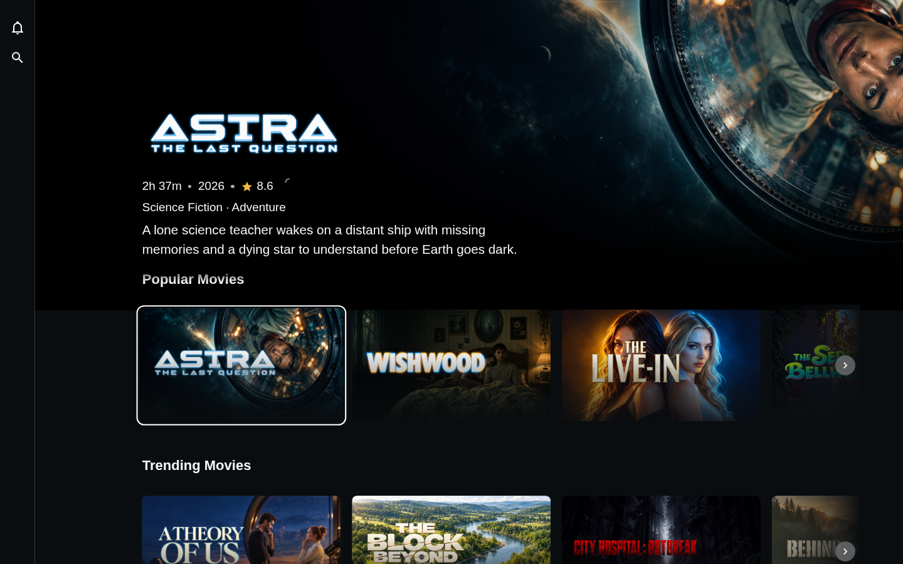
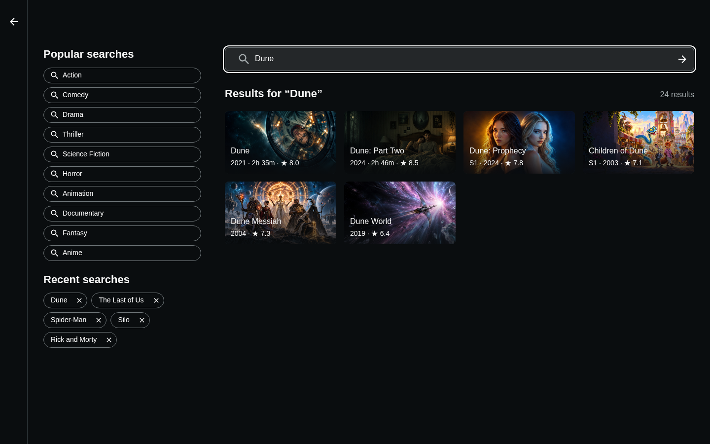
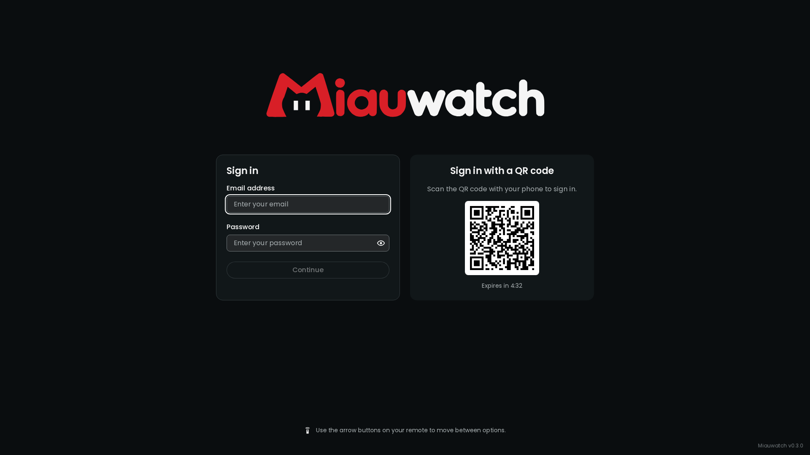
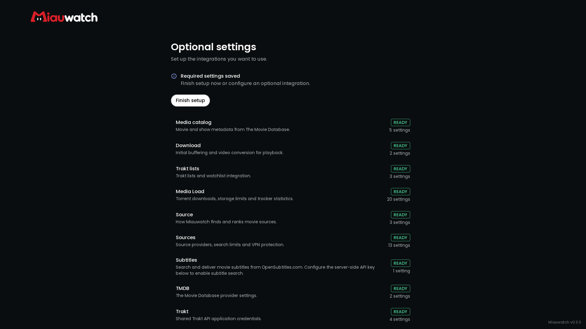

<p align="center">
  
</p>

[](LICENSE)
[](https://github.com/maury91/miauwatch/actions/workflows/ci.yml)

Miauwatch is a self-hosted app for watching movies and TV shows in your browser or on your TV. While you’re looking at a title, Miauwatch can already find a source, check its audio and subtitles, and start downloading the first pieces. It does that in the background so playback can be ready by the time you press **Watch Now**.

[Quick start](#quick-start) · [Screenshots](#screenshots) · [Documentation](docs/README.md)

## Quick start

You'll need [Docker with Compose](https://docs.docker.com/get-docker/) and a free [TMDB API read access token](https://developer.themoviedb.org/docs) for the catalog.

You can also connect these services:

- [Trakt](https://trakt.tv/oauth/applications) for Trakt lists and syncing playback progress. Create an OAuth application to get a client ID.
- [OpenSubtitles](https://www.opensubtitles.com/consumers) for finding additional movie subtitles. You'll need an API key.
- [Jackett or Prowlarr](docs/features/sources.md#connecting-jackett-or-prowlarr) for searching indexers you already use. Enter the Torznab URL and an API key if your endpoint requires one. (note: Prowlarr definitions are auto-synched, you do not need to setup or run a Prowlarr instance).

In an empty folder, download the Compose file and start Miauwatch.

```bash
curl -fsSLO https://raw.githubusercontent.com/maury91/miauwatch/main/docker-compose.yml
docker compose up -d
```

Open <http://localhost:3000>, create your admin account, and enter your TMDB token. The default setup is reachable only from the machine running Docker. Once your admin account exists, you can [open Miauwatch to your local network](docs/setup/docker-setup.md#open-it-to-your-local-network).

### Watch something

With the default settings, source search and downloads require a VPN. See the [VPN setup guide](docs/setup/docker-setup.md#using-a-vpn).

Open a movie or episode you have permission to watch and select **Watch Now**.

## What you can do

- Use a remote to browse and play on your TV. Scan the sign-in QR code with your phone.
- Keep a watchlist, rate titles, and pick up where you left off. You can also sync your watchlist and playback progress with Trakt.
- Search across multiple source providers, including Jackett and Prowlarr integrations. Miauwatch picks a source that suits your device.
- Keep downloads on your server. Miauwatch encrypts each download with its own key, uses random file and directory names, and pads file sizes.

See the [feature guide](docs/features.md) for details and the [task list](ToDo.md) for planned work.

## Screenshots

<p align="center">
  <br>
  <sub>Browse the catalog</sub>
</p>

<p align="center">
  <br>
  <sub><b>Details</b>: pick a movie, Watch Now</sub>
</p>

<p align="center">
  <br>
  <sub><b>Search</b>: on-screen keyboard, genres and recent searches</sub>
</p>

<p align="center">
  <br>
  <sub><b>Sign in</b>: with email, or by scanning the QR code with your phone</sub>
</p>

<p align="center">
  <br>
  <sub><b>Setup</b>: everything is configured from the browser</sub>
</p>

## Setup guides

- [Watch from another device on your network](docs/setup/docker-setup.md#open-it-to-your-local-network)
- [Install the Samsung TV app](docs/setup/samsung-tv.md)
- [Deploy on a domain with HTTPS](docs/setup/docker-setup.md#https-with-a-domain)
- [See the prebuilt Docker images for AMD64 and ARM64](docs/setup/docker-setup.md#prebuilt-images)
- [Configure environment variables](docs/setup/environment-variables.md) or [set up FlareSolverr](docs/setup/flaresolverr.md)
- [Read about the design decisions behind Miauwatch](docs/philosophy.md)

## Contributing

The [contributing guide](CONTRIBUTING.md) walks you through setting up a development environment.

## License

This project is source available under the [PolyForm Noncommercial License 1.0.0](LICENSE). You may use, modify, and share it for permitted noncommercial purposes. Commercial use requires separate permission from the relevant rights holders. See the license for its full terms, including permitted organizational uses.

This license applies to project-owned code and original materials. Third-party libraries, assets, and catalog artwork retain their own licenses and rights. It does not revoke licenses already granted for earlier versions, including earlier MIT-licensed copies.
