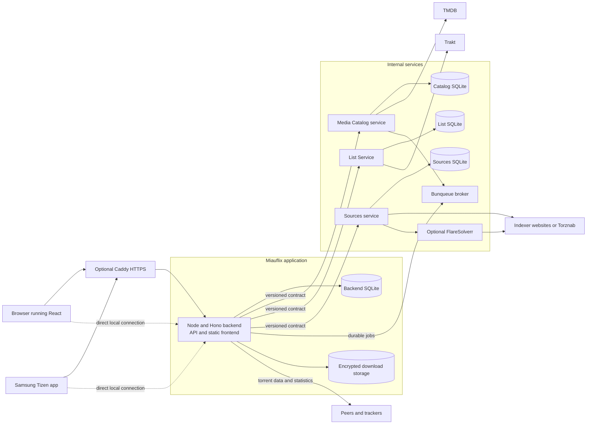
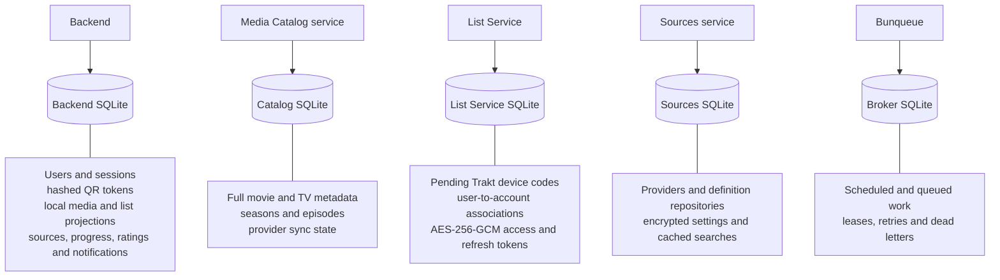
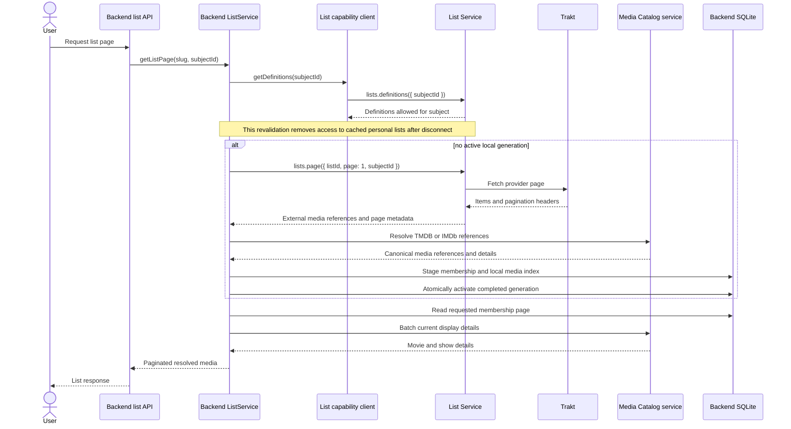
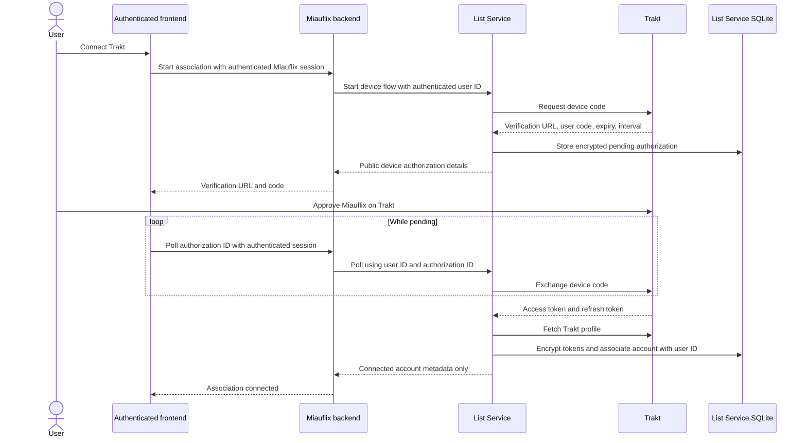
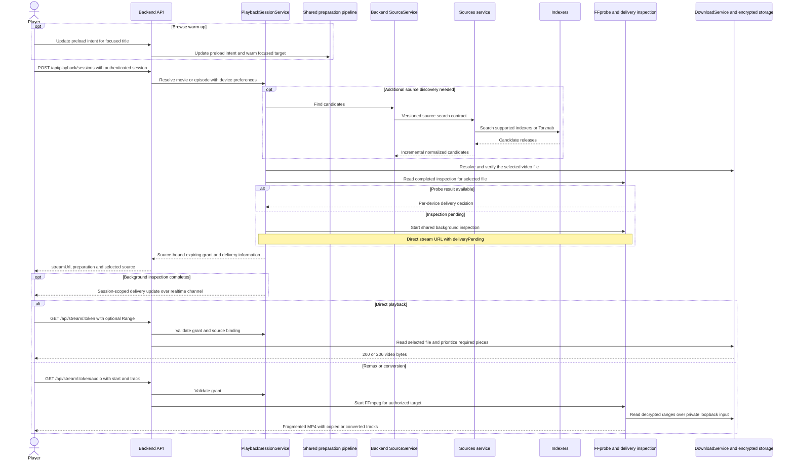
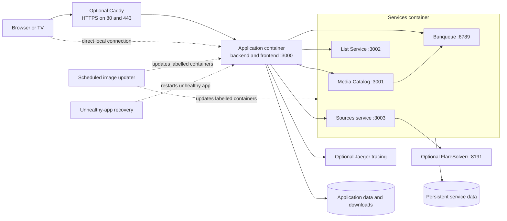

# Miauflix Architecture Diagrams

These diagrams describe the current runtime and ownership boundaries. The arrows show who calls
whom; the database shapes show ownership. See the [system overview](system-overview.md) for details
and the [feature guide](../features.md) for user-facing explanations.

## 1. System context and runtime services



The backend hosts the browser frontend and public `/api` routes. The Tizen app is packaged on the
TV. The browser and TV can connect directly on a trusted network or through the optional HTTPS
proxy. Catalog, list, and source clients each use a versioned contract over a persistent WebSocket
connection; these internal services are not public browser APIs. See
[the contract design](service-contract-v2.md).

Source website requests belong to the sources service. Torrent data and tracker statistics remain
backend responsibilities; these are different outbound paths.

## 2. Storage and credential ownership



Ownership invariants:

- The backend never stores Trakt credentials and Trakt is not a Miauflix identity provider.
- The List Service is the only reader and writer of Trakt association secrets.
- The sources service owns indexer definitions, credentials/settings, and search caches; the backend
  owns persisted candidates, verification, episode associations, and playback.
- The Media Catalog service is the only owner of full provider metadata; the backend keeps only the
  projection needed for lists, source discovery, and playback.
- Public list projections use the `public` subject. Personal projections use the authenticated
  Miauflix user ID and remain available only while the provider still defines that list for the
  subject.

## 3. Provider list ingestion and query



Unresolvable provider items are skipped. A failed refresh discards its staging generation, leaving
the previous active generation readable. Background refreshes carry the same subject ID and use
page fan-out followed by generation activation.

## 4. Authentication and account association are separate

### Miauflix QR login

```mermaid
sequenceDiagram
  actor Screen as Requesting device
  actor Phone as Approving device
  participant API as Miauflix backend
  participant DB as Backend SQLite

  Screen->>API: POST /api/auth/qr
  API->>DB: Store hashed approval and claim tokens with expiry
  API-->>Screen: requestId, claimToken, approval URL, expiry, interval
  Screen-->>Screen: Render approval URL as QR code
  Phone->>API: Open Miauflix approval URL
  API-->>Phone: Device context and pending state
  Phone->>API: Authenticate with Miauflix email and password
  Phone->>API: Approve or reject request
  API->>DB: Conditional pending-to-approved or pending-to-rejected update

  loop Until terminal state or expiry
    Screen->>API: POST /api/auth/qr/:requestId/claim with claimToken
    API->>DB: Match token and request ID; atomically claim once
    API-->>Screen: 202 pending, or authenticated session when approved
  end
```

The approval and claim tokens are independent, short-lived, stored only as hashes, and bound to the
same request ID. The final state transition is single-use and race-safe. Approval requires an
authenticated Miauflix account; a device already signed in does not need to enter its password again.

Browser login and QR claim deliver access and refresh tokens as session-scoped HttpOnly cookies.
The client identifies its session with `X-Session-Id`; middleware reads the matching access cookie
first and then falls back to `Authorization: Bearer`. A packaged TV app requests
`X-Auth-Transport: token` and receives tokens in the response body; it uses Bearer access tokens and
`X-Refresh-Token` for refresh/logout. See [token transport](../../backend/src/utils/auth-transport.util.ts).

### Trakt account association



Trakt proves access to a Trakt account; it never authenticates a Miauflix user. Disconnecting asks
the List Service to revoke the provider token and remove the association.

## 5. Playback and streaming path



A playback grant binds a user, playable identity, and source; target resolution selects the associated
file. The preparation pipeline and player can try another source when one fails. The stream route
also accepts movie keys issued by `POST /api/movies/:mediaId/:quality`.

Compatible audio/video can remain unchanged. Selected unsupported audio is converted to stereo
AAC. HEVC delivery depends on device support; optional H.264 conversion is disabled by default and
capped at 1080p/30 fps. Text subtitles have a separate authorized WebVTT path. See
[streaming services](../../backend/docs/streaming-services.md) for routes and limits.

Request-time source and metadata resolution calls its owning services directly. Bunqueue supplies
durable discovery, statistics, acquisition, and maintenance work; broker failures can affect
preparation and follow-up operations that enqueue jobs.

## 6. Container topology and optional deployment layers



The [base Compose file](../../docker-compose.yml) publishes port 3000 on localhost by default. It
runs one application container, one combined services container, and update/recovery helpers.

The [HTTPS overlay](../../docker-compose.https.yml) adds Caddy for a configured domain. The
[VPN overlay](../../docker-compose.vpn.yml) adds Gluetun/NordVPN and moves the application,
services, and enabled outbound helpers into its shared network namespace. Only in that VPN setup
do internal service URLs switch to `127.0.0.1`; the base deployment uses service hostnames.
FlareSolverr and Jaeger are optional overlays. Developers can also run the catalog, list, and source
services as individual processes or containers.
