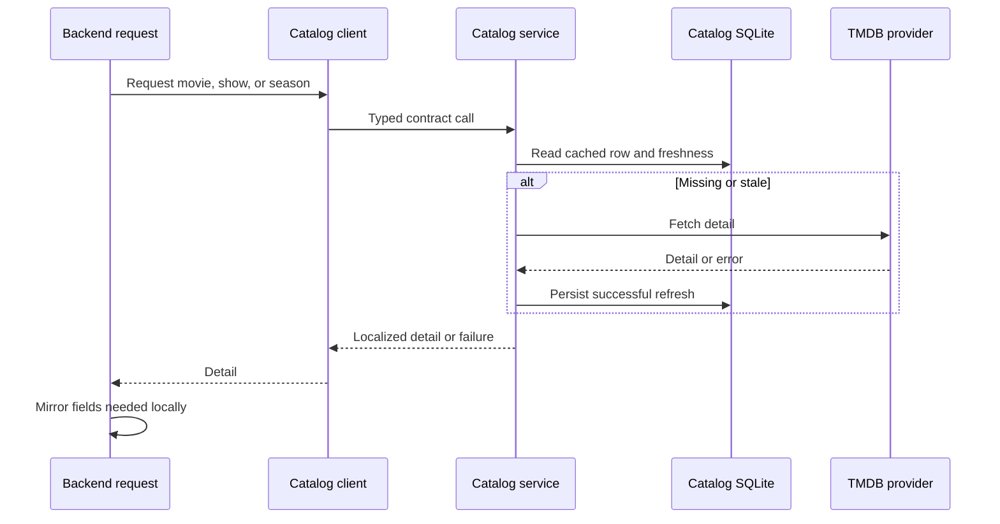

# External synchronization and query fallback

Miauflix separates provider synchronization from request-time data loading. The catalog, list, and source services own their provider access and caches. The backend combines their responses with its local indexes and account/playback state.

See [System overview](system-overview.md) for service ownership and [Service contracts](service-contract-v2.md) for the internal transport.

## Data ownership and query paths

| Data                                                                  | Authoritative owner             | Backend use                                                                |
| --------------------------------------------------------------------- | ------------------------------- | -------------------------------------------------------------------------- |
| Movie/show/season metadata and artwork                                | Catalog service, backed by TMDB | Resolves detail and mirrors fields needed for local joins and playback     |
| Provider list definitions, pages, and Trakt associations              | List service                    | Resolves media references and maintains ordered list projections           |
| Indexer definitions, search caches, and provider request state        | Sources service                 | Persists candidates and search coverage, matches files, and verifies video |
| Local watchlists, ratings, progress, source associations, and storage | Backend                         | Supplies account state, availability, authorization, and playback          |

`CatalogClientService`, `ListClientService`, and `SourcesClientService` use versioned contracts over their remote connections. The backend does not fetch TMDB, Trakt, or indexer pages as a fallback when a remote service is unavailable.

## Catalog reads and freshness

A movie or show detail request reaches the catalog service through the catalog client. The catalog hydrator checks its persisted row and freshness timestamp. A sufficiently fresh row is used directly; a missing or stale row is refreshed from the configured provider and stored before localization and response assembly.

Concurrent requests for the same movie, show, or season share hydration work. Seasons have their own episode freshness state. A season request ensures the show and requested season are loaded; it does not require every season to be loaded first.

If refresh fails with a non-`HttpError` exception and a persisted row exists, the hydrator can serve that stale row. A missing record has no stale fallback. Provider not-found responses remain errors rather than reviving a deleted record. A catalog batch returns successful details, missing references, and per-item errors separately, allowing a page to retain successful items.

The backend's `MediaService` mirrors resolved movie, show, and season details into its local indexes. Those indexes provide local IDs and associations for source matching and playback; full catalog freshness belongs to the catalog service.

Implementation: [catalog hydrator](../../services/media-catalog/src/catalog/catalog.hydrator.ts), [catalog service](../../services/media-catalog/src/catalog/catalog.service.ts), and [backend media mirroring](../../backend/src/services/media/media.service.ts).

## List pages and local projections

The list service supplies provider membership as external media references. It caches public pages for 15 minutes and personal pages for two minutes. Concurrent requests for the same page share the provider fetch. Cached page payloads are encrypted.

Personal cache access requires a connected account. The cache key and refresh checks account for the current association, and an association change invalidates an in-flight result. If the provider fails while the association remains valid, an existing cached page can be returned stale; without one, the error propagates.

The backend resolves external references through the catalog, obtains detail batches, and updates its local movie/show indexes. For a list with an active projection generation, API pagination reads ordered membership from that generation and resolves only the requested page's details.

For a list without an active generation, the request fetches only the provider pages needed to satisfy the requested API page. It does not wait for a complete background list refresh. Full refreshes stage pages under a generation ID and activate the generation after the staging work succeeds. Activation updates the active generation and removes superseded membership transactionally.

The local personal watchlist is backend-owned state, separate from these provider projections. Linking Trakt can add provider watchlist entries into that durable local watchlist; add/remove actions synchronize with the connected provider.

Implementation: [list page cache](../../services/list-service/src/list-page-cache.ts), [backend list queries and projection](../../backend/src/services/media/list.service.ts), and [generation repository](../../backend/src/repositories/mediaList.repository.ts).

## Source searches and metadata

Indexer results identify candidate releases, not verified playable files. The sources service emits candidates incrementally and ends with search coverage and retry information. The planner applies provider priorities, request budgets, caching, capability checks, and cooldowns.

The backend persists candidates and associations as results arrive. For a movie with no stored sources, on-demand callers join one in-flight search. The request waits for a bounded period and returns available persisted results; the search continues draining after that caller's deadline. Already stored sources can be returned without launching that on-demand search path.

Torrent metadata retrieval and usable-video verification are distinct operations. The backend can resolve torrent metadata when playback requires it, while background jobs also process pending metadata and verification. Source statistics come from peer/tracker work in the backend, not from the catalog cache.

Implementation: [source orchestration](../../backend/src/services/source/source.service.ts), [source planner](../../services/sources/src/planner/planner.ts), and [sources contract](../../packages/service-contracts/src/sources.ts).

## Scheduled work

The shared Bunqueue broker persists scheduled and queued work. The backend coordinates recurring schedules according to configuration and remote-service readiness. Backend workers handle list refresh planning/staging/activation, source discovery/metadata/statistics/verification, availability checks, watchlist acquisition/synchronization, and cache cleanup.

Catalog workers consume changed-movie scans, changed-show scans, and season synchronization jobs. `EPISODE_SYNC_MODE` selects watched-show-focused synchronization (`ON_DEMAND`) or incomplete seasons across shows (`GREEDY`). These jobs complement request-time hydration rather than replacing it.

List refresh planning submits page-staging jobs and an activation step. Jobs have explicit priorities, concurrency, leases, retry settings, and deduplication keys. Request-time detail hydration and cold-list pagination call their services directly rather than waiting for those background jobs to execute.

## Failure boundaries

- A configured remote service must be connected and ready for ordinary contract calls. Local indexes do not supply an automatic replacement for every unavailable service operation.
- Catalog and list caches apply the specific stale-data rules described above; there is no universal stale fallback covering all requests.
- Request-time hydration does not require a queued hydration job to finish. Broker failure can still affect preparation, acquisition, scheduled refresh, and follow-up work.
- Local viewing progress and watchlist intent persist independently of a temporary Trakt failure. Synchronization uses retries and explicit fallback behavior in the relevant owner.
- Source search results can remain pending while discovery or verification runs. Catalog presence, candidate presence, and verified playback availability are separate states.

Implementation: [schedule coordinator](../../backend/src/services/background-job/service-schedule.coordinator.ts), [backend job handlers](../../backend/src/services/background-job/background-job.handlers.ts), [job definitions](../../backend/src/services/background-job/background-job.types.ts), [catalog workers](../../services/media-catalog/src/workers/worker.ts), and [remote readiness handling](../../backend/src/services/remote/remote-service.ts).
