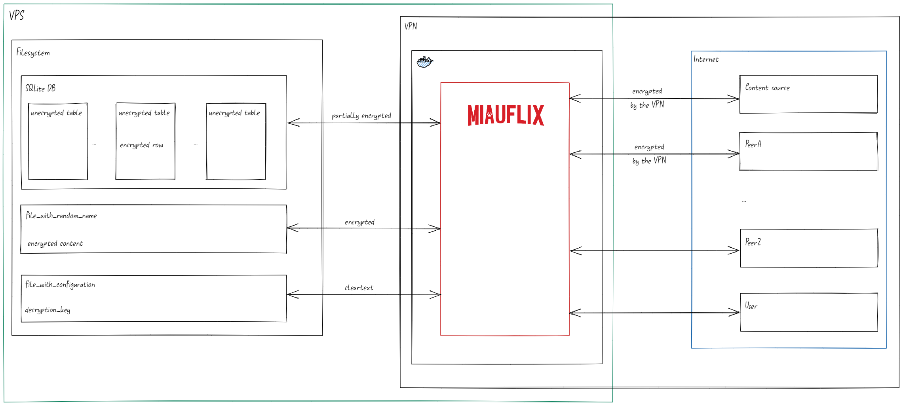

# Philosophy

Miauflix is based on these principles:

## Simplicity

Starting Miauflix on your machine or VPS must be as easy as possible.
The setup accommodates both beginners and advanced users.

If you’re a beginner running Miauflix locally, run the wizard and start a single Docker container—you don’t even need to clone this repository.

If you’re an advanced user, everything is ready for you to set up a full website with SSL, custom domain, VPN, and anything else you might need.

## Resilience

Miauflix is designed to work with multiple sources. Many are integrated into the codebase so you can use them without installing anything else (simplicity principle).  
Others can be added so Miauflix can still work even if those sources are not available anymore.

> Note: This principle is not fully implemented yet; integration with Prowlarr and Jackett is planned.

## Running everywhere

Miauflix is designed so you can run it in a possibly hostile environment, like a VPS that is partially monitored by the provider.

### First part: obfuscation

Miauflix encrypts sensitive data at rest. The application must access the decryption key at runtime; accordingly, a host with root access could also access it.

When SSL is configured, data in transit is protected via HTTPS (TLS). A VPN is recommended for upstream privacy and ISP/provider exposure reduction, but it is not a substitute for HTTPS.  
For stronger protection, store encryption keys in an external secrets manager (e.g., HashiCorp Vault, AWS KMS) and inject short‑lived keys at runtime.

### Second part: authentication

To run outside your local network, Miauflix must support user authentication.

Miauflix provides a closed authentication system: an admin can create users; self‑signup is not available.

The purpose is to let you deploy your instance of Miauflix in a server exposed to the internet, while ensuring only authorized users can access it.

## Speed

Miauflix is designed for fast start times. The tenet is: "When a user clicks Watch Now, streaming should start in under 2 seconds."

To achieve this, Miauflix uses background processing, preloading, and priority queues.

When idle, Miauflix searches for new content and preloads data needed for streaming.

- Periodic synchronization of catalog metadata and Trakt-backed lists
- Periodic source discovery of recently acquired content and re-discovery of older content
- Pre-download of content marked as "continue watching" (e.g., new episode of a TV show)

Miauflix prioritizes content the user shows intent to watch (e.g., opening a movie detail). If data isn't present, it's fetched with priority and downloading begins so some content is ready when the user clicks Watch Now.

Miauflix supports streaming while downloading.
