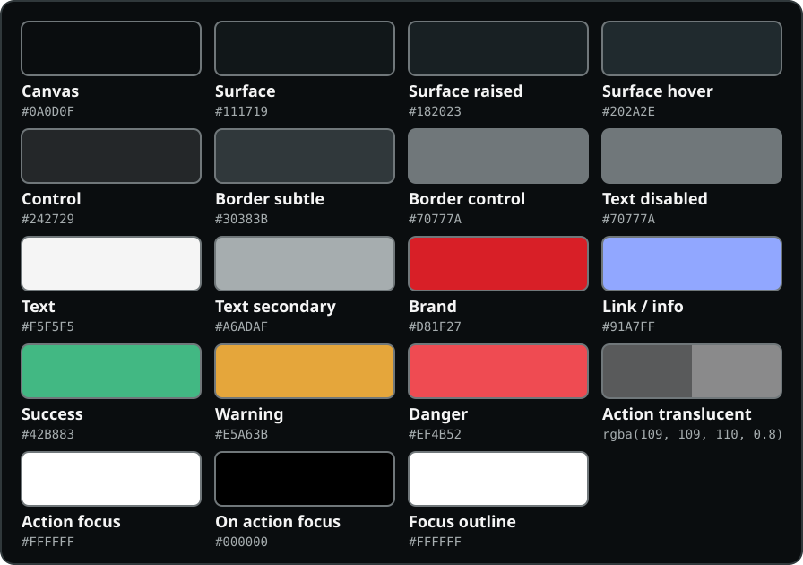
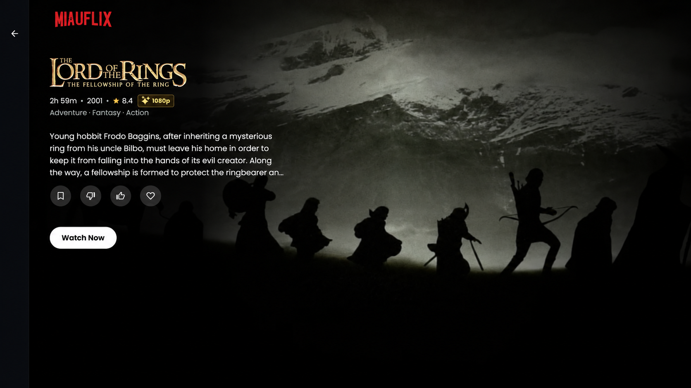
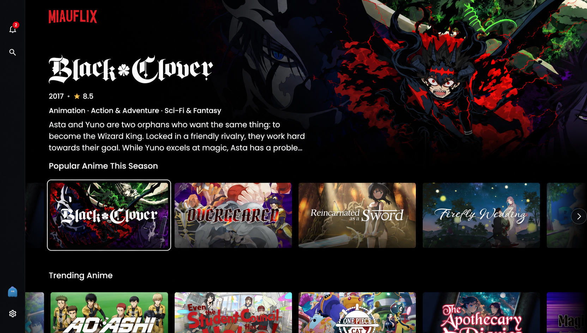
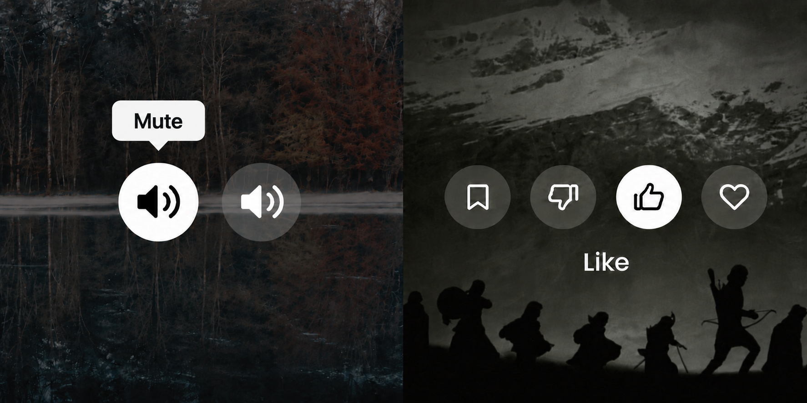

# Miauflix design system and adoption plan

Status: plan, not yet implemented. Last updated 2026-11-14. Repository findings refer to `maury91/miauflix` main at `c84c4fcd112939ef140c36baf317c2abfe3dc2d3` unless stated otherwise.

The target architecture is designed independently of today's component extractions. Existing code supplies product requirements, platform constraints, tuned behavior and migration locations; its component boundaries and names are not constraints. Decisions already taken are listed in section 15; open questions in section 16.

Contents:

1. Purpose and principles
2. Current state of the frontend
3. Color and tokens
4. Actions, focus and state
5. Foundation values
6. Styling and rendering performance
7. Internal primitives
8. Public components and product patterns
9. Direction rules
10. Focus architecture
11. Design and anti-duplication rules
12. Storybook as the specification
13. Adoption plan
14. Validation and definition of done
15. Decision log
16. Open questions
17. References

## 1. Purpose and principles

Build one product design system with four layers:

1. Foundations: semantic tokens, typography, surfaces, density, iconography and motion.
2. Internal behavior: focus, activation, text editing, overlay lifecycle and accessibility wiring.
3. Public building blocks: controls, containers, fields, collections and feedback.
4. Product patterns: media tiles, settings rows, search keyboards and player chrome, assembled from the public blocks. Features own API calls, DTO mapping, Redux, validation, route changes and playback state.

The same user interaction has the same base implementation everywhere. A password field in setup and a password field in login are the same component. An eye action, a notification close action and a player mute action use the same IconButton. A provider row and an episode row share a ListItem shell even though their data and actions differ.

Do not unify unrelated interaction semantics just because they look alike: Button, Link, Checkbox and Slider need different native behavior. Share their internal surface, sizing, icon and focus treatments instead of forcing everything through a polymorphic Button.

Success is not minimizing exported names. Success is eliminating duplicate ownership of appearance and behavior while keeping composition clear and accessible.

### Design principles

Ordered; when two conflict, the earlier one wins.

1. **Content first.** Artwork, titles and playback are the interface. Chrome stays quiet: actions are transparent or translucent at rest, brand red is never a button, and controls get out of the way during playback.
2. **Focus is never in doubt.** At any moment exactly one element looks focused, recognizable from 3 m away, and the treatment is the same on every screen.
3. **Every direction has one meaning.** Vertical moves between groups, horizontal moves within a group; no control sits where the remote cannot reach it in a straight line (Google TV "optimize with axes" / "clear path").
4. **One way to do each thing.** The same interaction has the same component, look and keys everywhere (Ant Design's "certainty"). A new variant must remove an inconsistency, not add one.
5. **Fast beats fancy.** Anything that costs frames on Tizen 5.5 / Chromium 69 is cut or simplified before it ships.

## 2. Current state of the frontend

What exists and is worth keeping, reusing or measuring against:

- React 19, TypeScript, Vite and Storybook 10 with Docs, accessibility, Vitest and Chromatic integration. Playwright story snapshots cover Home, Search, profiles, notifications, player, QR and Trakt flows. Configured integration is not evidence that every check runs in CI. Storybook accessibility checks use `test: 'todo'`, so findings do not fail the suite yet.
- `frontend/src/shared/ui` contains Button, ActionRow, Input, Select, FieldLabel, Switch, Alert, ErrorNotice, Spinner, LoadingIndicator, Modal, StatePanel, MediaCard, PosterCard, QualityBadge, Metadata, BackRail and Logo, plus Introduction and Composition MDX pages.
- `tokens.ts` has two palettes: `PALETTE` (brand red as interactive and link color) and `SETTINGS_PALETTE` (light-gray primary button, blue `#5C7CFA` interaction accent, red danger). Button gradients and media/progress styling still contain literal colors.
- Units are inconsistent: about 25 distinct font sizes (11–13px common) across px, rem, em, vw and `clamp()`; layouts mix vw/vh paddings with px.
- Styling is mostly styled-components (runtime CSS). Only `MediaCard.css.ts` uses vanilla-extract, following `docs/development/css-architecture.md`. The Tizen build has a legacy plugin that rewrites `clamp()`, `min()`, `aspect-ratio` and `gap`; inline styles bypass it.
- Icons come from unplugin-icons (`~icons/*`): `mdi` (~70 imports), `line-md` (11, animated), and one-off `ion`, `octicon`, `cib`.
- Home row geometry in `frontend/src/pages/home/home-layout.ts` (`mediaBoxSizes`) is tuned and scales correctly across resolutions; MediaCard's focus scale (1.03, 150 ms ease-out) is tuned too. Both are kept (section 5).
- Keyboard: `useKeyboard` normalizes arrows, Confirm, Back, Search and media keys; supports nested/exclusive scopes, native-editing guards and lost-focus recovery. `useKeyboardNavigation` registers element scopes. These are foundations, not yet a layout-driven focus tree.
- Navigation behaviors to preserve: Home remembers category/card focus, loads rows asynchronously and steps held arrows every 90 ms; Search has a deterministic zone/grid resolver with spanning keyboard keys; profiles use geometry-based region navigation; player controls have their own levels (header → video → prompt → seek → action row); login has a show/hide password control, TV arrow handling and Tizen IME Done.
- `@noriginmedia/norigin-spatial-navigation` is still listed as a dependency but nothing imports it; it is removed (phase 0).
- There is no i18n library yet; all copy is hard-coded. i18n will be integrated (section 11).
- Modal implements a two-action contract only; general form dialogs need real focus containment.

## 3. Color and tokens

### Token layers

Three layers, following Ant Design's seed/map/alias/component split without its runtime algorithms:

1. Primitive: raw values (`gray900 = #0A0D0F`, `space4 = 1rem`). Private to the library.
2. Semantic: roles (`canvas`, `text`, `space.md`, `type.body`). What components and layouts use.
3. Component: a small fixed table per component (`button.height.md`, `tile.focusScale`), derived from semantic tokens and documented in Storybook. Features can read them, never override them.

There are no separate login/settings/player palettes. `PALETTE` and `SETTINGS_PALETTE` collapse into this single set; the settings blue has no role. Context can select an inherited surface treatment, but must not redefine control anatomy or invent a new focus color.

| Axis            | Contract                                                                                                                                                                                                                                                                           |
| --------------- | ---------------------------------------------------------------------------------------------------------------------------------------------------------------------------------------------------------------------------------------------------------------------------------- |
| Color           | `canvas`, `surface`, `surfaceRaised`, `surfaceHover`, `control`, `borderSubtle`, `borderControl`, `text`, `textSecondary`, `textDisabled`, `brand`, `link`, `success`, `warning`, `danger`, `info`, `actionTranslucent`, `actionFocus`, `onActionFocus`, `focusOutline`, `scrim.*` |
| Action styling  | No emphasis levels and no tones. An action's look is fully determined by its surface context and its state (section 4)                                                                                                                                                             |
| Feedback tone   | `info`, `success`, `warning`, `danger`; used by Message, Badge and field validation, never by action fills                                                                                                                                                                         |
| Surface context | `solid`, `overMedia`. Set by the container (details artwork, Player chrome and artwork-backed panels set `overMedia`), read by actions. Not a per-button prop                                                                                                                      |
| Size            | `sm`, `md`, `lg` (section 5)                                                                                                                                                                                                                                                       |
| Density         | `web`, `tv`; implemented only as the root font size (section 5)                                                                                                                                                                                                                    |
| Shape           | `sm`, `md`, `lg`, `full`                                                                                                                                                                                                                                                           |
| Spacing         | eight rem steps                                                                                                                                                                                                                                                                    |
| Typography      | display, title, heading, body, label, caption                                                                                                                                                                                                                                      |
| Layer           | content, sticky chrome, popover, modal backdrop, modal, tooltip, notification                                                                                                                                                                                                      |
| Motion          | instant, fast, standard, panel                                                                                                                                                                                                                                                     |

### Palette



| Role                              | Value                                                     | Notes                                                                                                     |
| --------------------------------- | --------------------------------------------------------- | --------------------------------------------------------------------------------------------------------- |
| Canvas                            | `#0A0D0F`                                                 | Product background                                                                                        |
| Surface / raised / hover          | `#111719` / `#182023` / `#202A2E`                         | One surface ladder; also expresses elevation                                                              |
| Control                           | `#242729`                                                 | Field/control background                                                                                  |
| Border subtle / essential control | `#30383B` / `#70777A`                                     | Decorative and essential boundaries are different roles                                                   |
| Text / secondary                  | `#F5F5F5` / `#A6ADAF`                                     | Essential helper text uses secondary                                                                      |
| Disabled                          | `#70777A`                                                 | Disabled information only; not ordinary helper copy                                                       |
| Brand                             | `#D81F27`                                                 | Logo, progress bars, seek bar (watched portion, downloaded-piece blocks). Never a button, tab or nav fill |
| Link / info                       | `#91A7FF`                                                 | Underlined links; informational accent                                                                    |
| Success / warning / danger        | `#42B883` / `#E5A63B` / `#EF4B52`                         | Status always also has an icon or text label                                                              |
| Action translucent                | gray at ~80% opacity, proposal `rgba(109, 109, 110, 0.8)` | Over-media action at rest; selected action on solid surfaces                                              |
| Action focus / on action focus    | `#FFFFFF` / `#000000`                                     | Focused action fill and its label/icon                                                                    |
| Focus outline                     | `#FFFFFF`                                                 | Focus for controls that cannot invert                                                                     |

Contrast: rendered text 4.5:1 (normal) and 3:1 (large); essential control boundaries 3:1. Alpha, gradients and artwork need checks on the composed background, not the swatch. For actions, what must stay readable is the button's own content against its fill; whether a focused white button stands out from bright artwork behind it is accepted, not a requirement.

There is no primary/secondary/danger button styling anywhere in the product (TV browsing, player, login, setup, settings). A group's main action is expressed by order, placement and initial focus, matching Google TV's rule that the first button in a group is the primary one because focus lands on it first. Destructive actions are expressed by their label and, where needed, a confirmation Dialog whose initial focus is the least destructive choice. No `appearance`, `color`, `tone` or `emphasis` props on Button.

Never let one color mean focus, selection and error at once: white means focus, selection uses a fill or a filled icon/check, validation uses the danger color plus text and an icon.

## 4. Actions, focus and state

Every focusable component uses exactly one of two focus treatments.

### Inverted fill: actions

Button, IconButton, Tab, NavItem, selectable Chip, Select trigger, Menu/OptionList items and on-screen keyboard keys. The surface context picks the rest look; focus always looks the same:

| Surface context                             | Rest                                       | Selected, not focused                                                                                 | Focused (also focused + selected) |
| ------------------------------------------- | ------------------------------------------ | ----------------------------------------------------------------------------------------------------- | --------------------------------- |
| `overMedia` (details, Player, artwork)      | `actionTranslucent` fill, white label/icon | Same as rest; selection must be carried by icon/label (filled vs outlined icon, a check in an option) | White fill, black label/icon      |
| `solid` (rail, tabs, pages, dialogs, forms) | Transparent, white label/icon              | `actionTranslucent` fill, white label/icon                                                            | White fill, black label/icon      |



_Proposed action styling on the existing movie details screen._

"Selected" means current state, not focus: the Home tab while Home is displayed, the active profile-editor tab, the chosen option in a list. When focus leaves a selected action it returns to the selected look. Actions do not scale on focus.

### Outline: everything that cannot invert

Text fields, TextArea, NumberField input, MediaTile/CollectionTile/ProfileTile, ListItem rows, Switch, Checkbox, Radio, Slider/SeekControl. The focused element gets a white `focusOutline` outside its box, `0.125rem` wide with `0.125rem` offset (2px on web, 3px on TV), following the element's radius.

Unlike TV UIs that never expose an editable field (typing goes through an on-screen keyboard into a non-focusable display), Miauflix keeps real editable inputs on every platform, so fields need this treatment. An invalid focused field shows both the outline and its error border/text.

Chromium 69 draws `outline` as a rectangle that ignores `border-radius`. Draw the outline with an absolutely positioned pseudo-element carrying the border and radius, toggled with `opacity`, so it follows the shape, causes no layout and changes only compositing. A shared FocusIndicator recipe owns this; no component draws its own.

### Other states

- **Hover** is not a state. Moving the pointer onto an element focuses it (see "Virtual focus"), so there is never a separate hover look and never two highlighted items.
- **Pressed:** white fill darkened to about `#E0E0E0` for the duration of the press; no scale or size change (proposal, see section 16).
- **Disabled:** label/icon at about 40% opacity, no fill change, skipped by navigation. Reserved for unavailable actions. Never `aria-disabled` without also suppressing activation.
- **Loading:** the icon slot shows the spinner, which is just an animated icon in the current content color (white at rest, black when focused). Label, size and focus stay; `aria-busy` is set and duplicate activation is blocked.
- **Read-only** fields stay focusable for reading and copying.

Keep states independent: availability (enabled/disabled/read-only), interaction (rest/hover/focus/pressed), validation (none/invalid), async (idle/loading), selection (checked/selected/expanded), content (empty/populated/missing artwork/truncated). No single `status` enum. Use native attributes and ARIA where they exist and data attributes otherwise. Document valid combinations per component (focused + invalid, selected + focused, loading + focused, disabled + selected, expanded + focused); not every state applies to every component.

### Virtual focus

Focus is virtual. The navigation layer (section 10) owns the one focused element and every component renders it from that state, as `data-focused`. DOM focus and the browser's `:focus`, `:focus-visible` and `:hover` never decide what looks focused.

- **Keys** move virtual focus (section 9). Confirm activates the focused element through the same path as a click, so pointer and keys run one handler.
- **The pointer focuses what it moves onto.** Moving the mouse onto a focusable element makes it the focused element; that is the only hover behavior. A click activates it.
- **Keyboard animations lock the pointer.** When a key starts an animation that moves content (a row scrolling to its next page, a page scrolling to the next row), pointer focus is suspended until the animation ends. Otherwise a mouse resting over the moving content would focus whatever slides under it. Once the animation ends, the pointer focuses again on its next real movement; content that stopped under a resting pointer does not take focus.
- **DOM focus follows, never leads.** Real DOM focus is used only where the platform needs it: a text field in edit mode (caret, IME) and, where useful, mirroring the focused element for assistive technology. It never drives the navigation state.

Example, a Home category row: moving the mouse over a media tile focuses it, without scrolling. Pressing Left/Right scrolls the row by a page and focuses the tile that lands in the left-most visible slot; the pointer is locked until the scroll animation ends.

### Progress button: automatic actions

A progress button is an action that runs by itself when its countdown ends, such as "Next episode" at the end of an episode. It is the same button drawn twice, one on top of the other: the bottom layer in the rest look, the top layer in the focused look. Only the left part of the top layer shows, as wide (in %) as the countdown's progress, so the button fills from left to right, going from the rest look to the focused look. When it is completely filled, it runs its action.

While it counts down, the button holds focus and behaves like a focused button:

- **Confirm** (Enter, click, tap) runs the action at once and ends the countdown.
- **Any arrow key** ends the countdown, puts the button back to its rest look and lets the arrow move focus as usual. Losing focus any other way ends it too.
- After that it is an ordinary Button: focusing it again shows the normal focused look, and it never runs by itself again. Since focus is virtual, "losing focus" means the navigation state focusing another element. A new countdown needs a new progress button (a new prompt).

The action runs at most once, however it is triggered. The fill animates `transform` only (a clipping layer and its content translated in opposite directions), driven by CSS, with no JavaScript per frame. The countdown can be paused (for example while the video is paused) and can start partway through.

## 5. Foundation values

### Units and density

- Every size, spacing, type and radius token is in `rem`. Components do not use px, em, vw, vh or `clamp()` for these. Exceptions: 1px hairline borders, percentage widths for fluid web containers, and collection geometry (below), which is derived from the viewport.
- Density is nothing but the root font size, set by static CSS with no JavaScript:

| Context               | Root `font-size`       | Notes                                                                             |
| --------------------- | ---------------------- | --------------------------------------------------------------------------------- |
| Web (desktop, mobile) | 16px (browser default) | Respects user zoom and font-size settings                                         |
| TV, 1080p             | 24px                   | 1920×1080 CSS viewport; the whole UI is 1.5× web                                  |
| TV, 720p              | 16px                   | `@media (max-width: 1280px)` in the TV build; same layout, proportionally smaller |

This is Google TV's approach (design once on a 960×540 reference, scale proportionally to the panel) expressed in CSS. There are two densities only; TV-only differences (safe area, rail) are separate tokens, not a second scale.

### Type scale

Poppins, loaded in four weights only (400, 500, 600, 700). Six roles, deliberately fewer than Material 3's fifteen:

| Role    | Size     | Line height | Weight | Web px | TV 1080p px | Use                                            |
| ------- | -------- | ----------- | ------ | ------ | ----------- | ---------------------------------------------- |
| display | 3rem     | 1.1         | 700    | 48     | 72          | Hero and details title; at most one per screen |
| title   | 2rem     | 1.2         | 600    | 32     | 48          | Page title                                     |
| heading | 1.375rem | 1.3         | 600    | 22     | 33          | Row/section heading, dialog title              |
| body    | 1rem     | 1.5         | 400    | 16     | 24          | Descriptions and paragraphs                    |
| label   | 1rem     | 1.25        | 500    | 16     | 24          | Buttons, tabs, field labels, tile titles       |
| caption | 0.875rem | 1.4         | 400    | 14     | 21          | Metadata, helper and error text, badges        |

- Nothing is smaller than caption.
- Letter spacing 0. Sentence case for every label, title and button; uppercase only inside Badge.
- Buttons and tabs never wrap. Tile titles are one line with ellipsis. TV descriptions are clamped to three lines.
- Timecodes and counters use `font-variant-numeric: tabular-nums`.

### Spacing

| Token       | `2xs` | `xs` | `sm` | `md` | `lg` | `xl` | `2xl` | `3xl` |
| ----------- | ----- | ---- | ---- | ---- | ---- | ---- | ----- | ----- |
| rem         | 0.25  | 0.5  | 0.75 | 1    | 1.5  | 2    | 3     | 4     |
| Web px      | 4     | 8    | 12   | 16   | 24   | 32   | 48    | 64    |
| TV 1080p px | 6     | 12   | 18   | 24   | 36   | 48   | 72    | 96    |

Layout props (Stack gap, Section padding) accept only these names.

### Control sizes

Buttons, IconButtons, fields, Select triggers and tabs share one table. IconButton is a circle with the control height as its diameter.

| Size | Height | Horizontal padding | Icon    | Icon–label gap | Text role | Use                                               |
| ---- | ------ | ------------------ | ------- | -------------- | --------- | ------------------------------------------------- |
| `sm` | 2rem   | 0.75rem            | 1.25rem | 0.375rem       | caption   | Web only: dense rows, chips, inline field actions |
| `md` | 2.5rem | 1rem               | 1.5rem  | 0.5rem         | label     | Default everywhere (60px on TV)                   |
| `lg` | 3rem   | 1.5rem             | 1.75rem | 0.5rem         | label     | Details action row, player transport              |

- `sm` is not used on TV: 48px is below the ~56px TV target.
- On touch devices (`@media (pointer: coarse)`), `sm` and `md` extend their hit area to 2.75rem (44px) with a transparent pseudo-element, without changing the visual size.

### Shape

| Token  | Value   | Used by                                              |
| ------ | ------- | ---------------------------------------------------- |
| `sm`   | 0.25rem | Badges, progress bars, seek track                    |
| `md`   | 0.5rem  | Fields, tiles, list rows, tooltips, menus            |
| `lg`   | 1rem    | Dialogs, panels, popovers                            |
| `full` | 999px   | Buttons, IconButtons, chips, tabs, switches, avatars |

Every action is fully rounded: text buttons, tabs and chips are pills; IconButtons are circles.

### Collection geometry and tile focus

- Keep the Home row logic in `frontend/src/pages/home/home-layout.ts` (`mediaBoxSizes`) as the collection geometry contract for Carousel, MediaTile rows and Search results. Card width and gap are shares of the window height (35.2vh, 2vh); rows keep at least a 5vw side margin; as many whole cards as fit are centred, with at most half a card peeking on each side; every row has a fixed height (33vh) so rows are placed and scrolled without measuring. It is the documented exception to the rem rule and feeds the translate-based positioning in section 6.
- Tiles scale on focus with `transform`, keeping the tuned value from `MediaCard.css.ts`: `scale(1.03)`, 150 ms ease-out. The pointer focuses tiles instead of hovering them, so the separate 1.015 hover scale goes. Row geometry already leaves room for the growth.



_Proposed tile focus on the existing Home layout._

### Motion

| Token      | Duration | Easing                                                                | Use                                          |
| ---------- | -------- | --------------------------------------------------------------------- | -------------------------------------------- |
| `instant`  | 0 ms     | —                                                                     | Focus fill/color changes, outline appearance |
| `fast`     | 120 ms   | `cubic-bezier(0.2, 0, 0, 1)`                                          | Carousel track translate, pressed state      |
| `standard` | 180 ms   | `cubic-bezier(0.2, 0, 0, 1)`                                          | Tooltip, description slot                    |
| `panel`    | 240 ms   | enter `cubic-bezier(0.2, 0, 0, 1)`, exit `cubic-bezier(0.4, 0, 1, 1)` | Dialogs, popovers, player chrome show/hide   |

Tile focus scale keeps its tuned 150 ms. The ease-out curve is Material 3's emphasized easing; durations sit between Ant Design (100/200/300 ms) and MUI (150–375 ms), kept short for remote use. Animate only `transform` and `opacity`. A carousel transition interrupted by a held key retargets from its current position rather than queueing. Reduced motion sets every non-instant duration to 0 and removes scale.

### Layers

| Layer                                       | z-index |
| ------------------------------------------- | ------- |
| content                                     | 0       |
| sticky chrome (rail, header, player chrome) | 100     |
| popover / menu                              | 200     |
| modal backdrop                              | 300     |
| modal                                       | 310     |
| tooltip                                     | 400     |
| notification                                | 500     |

Spaced like MUI's scale, so a layer can be inserted without renumbering. Nothing outside the library sets `z-index` except 0/1 for local stacking. A notification never covers the focused control or takes focus.

### Breakpoints (web)

Material 3 window size classes: compact < 600px, medium 600–839px, expanded 840–1199px, large ≥ 1200px. Write media queries in `em` so they follow user zoom. TV is a density, not a breakpoint: it always uses the large layout. TV scaling never applies to web configuration forms.

### TV safe area

Interactive content and text stay inside `4rem` left/right and `2.25rem` top/bottom (96px/54px at 1080p, 5% of the screen, from Google TV). Backgrounds, hero artwork and scrims bleed to the screen edges. Safe gutters also leave room for focus outlines.

### Scrims and elevation

- Text over artwork always sits on a scrim. `scrim.hero` is a left gradient (canvas 90% → transparent at 60% width) plus a bottom gradient (canvas → transparent over 30% height); `scrim.tile` is a bottom gradient for text-on-image tiles; `scrim.modal` is canvas at 70%. All static.
- Elevation is expressed with the surface ladder (canvas → surface → surfaceRaised), as Material 3 does in dark themes, not with shadows. One static `shadow.overlay` is allowed for popovers and dialogs over media. No other `box-shadow`, blur, glow or `backdrop-filter`.

### Iconography

- One set: Material Design Icons (`~icons/mdi/*`). Remove one-off sets (`ion`, `octicon`); `cib` stays only for third-party brand logos.
- `line-md` only for animated icons: the loading spinner and other state animations.
- Outline icons at rest; the filled counterpart means on/selected (`mdi:subtitles-outline` → `mdi:subtitles`). This is how selection reads on `overMedia` surfaces, where the fill can't change.
- Icons are sized only by the control size table; standalone `Icon` uses the same three sizes. Decorative icons are hidden from assistive technology and are never focus targets.

## 6. Styling and rendering performance

These rules apply to every platform, not only Tizen 5.5 / Chromium 69:

1. **Prefer CSS that needs no conversion.** If a property can be written so it works as-is on Chromium 69 and stays understandable (margins instead of flex `gap`, explicit sizes instead of `clamp()`/`min()`), write it that way instead of relying on the TV legacy rewrite plugin. Use a construct that needs rewriting only when the plain alternative would be noticeably harder to read or maintain.
2. **Build-time classes.** Styles are classes generated at build time (vanilla-extract `.css.ts`, or any styled API that extracts static CSS at build time). The build injects the CSS into the document head, so styles are ready on first paint and cost no JavaScript. No runtime CSS generation (styled-components, CSS-in-JS props) in migrated code, and no dynamic CSS variables in paint properties on TV. Do not keep styled-components just because old components use it.
3. **Composable classes.** Shared recipes for surface context × state, size steps and typography roles, combined as class lists rather than duplicated per component. State is expressed through native/ARIA/data attributes on a stable class (`[aria-selected]`, `[data-focused]`, `:disabled`), not through new class strings computed in render. Continuous values (geometry, artwork URLs) are passed as final inline values.
4. **Protect the hot path** (focus moves, held keys, scrolling rows). Avoid properties that trigger layout, re-rendering lists on focus change and expensive paint (large blurs, animated shadows, `backdrop-filter`, `filter`). Focus and state changes touch only `transform`, `opacity` and colors. A focus change re-renders at most the previously and newly focused items, not their collection.
5. **Compute positions where they are known.** For carousels, tile grids, the on-screen keyboard, player overlays and the seek bar, place elements with absolute positioning or `transform: translate()` from known sizes instead of letting the browser lay them out, and scroll rows by translating a track rather than changing `scrollLeft`. Moving virtual focus never scrolls by itself: the owning collection reveals the item. Flow layout (Stack/Grid/flex) remains the default for content whose size is not known in advance: forms, settings, text, dialogs.

Geometry-dependent APIs need a Tizen-compatible path; ResizeObserver or modern CSS must not become an untested requirement.

## 7. Internal primitives

Implementation foundations, not a menu of low-level APIs every feature must assemble:

- `ControlSurface`: control geometry, border, foreground and surface-context × state recipes. Used by different semantic controls without rendering everything as a button.
- `FocusIndicator`: the inverted-fill and outline treatments, clipping allowance and Chromium 69 fallback, all from `data-focused`.
- `useAction`: pressed state, native activation and duplicate-activation protection. Pointer and keyboard activate exactly once, never a synthetic click plus a browser click.
- `useField`: stable IDs, label/control association, description/error IDs, required/read-only/invalid state.
- `useComposite`: active child, internal movement and entry/exit rules.
- `useOverlay`: open/close lifecycle, positioning, active layer stack, background suspension, dismissal and restoration.
- `useCollection`: stable item identity, active/selected distinction, disabled items and entry memory.

Expose these only when advanced shared components need them. Product pages consume complete public components. A raw Pressable is not a feature-level escape hatch for recreating buttons.

## 8. Public components and product patterns

This is the target catalog, independent of existing exports. Build required pieces first; keep the rest marked planned until implemented. Add components for demonstrated needs only; checkbox, radio, tooltip and notification infrastructure does not need to precede controls current screens already use.

### 8.1 Foundations and layout

| Component               | Responsibility and variants                                                        | Explicit exclusions                                    |
| ----------------------- | ---------------------------------------------------------------------------------- | ------------------------------------------------------ |
| `Text`, `Heading`       | Named typography roles, semantic element, truncation policy                        | Feature-local font sizes/weights                       |
| `Icon`                  | Shared icon sizing, decorative/named semantics, alignment                          | Per-page SVG sizing rules                              |
| `Surface`               | Background, border, radius from the surface ladder; static container by default    | Click handling or hidden button behavior               |
| `Divider`               | Horizontal/vertical separation                                                     | Navigation                                             |
| `Stack`                 | Axis, gap, alignment, distribution                                                 | Automatic keyboard interception                        |
| `Inline`                | Wrapping inline layout and alignment                                               | Hard-coded action styling                              |
| `Grid`                  | Columns, spans, gaps and responsive layout contract                                | Item-specific colors or selection                      |
| `Container`, `SafeArea` | Reading/form/full widths, viewport gutters, TV safe area                           | Feature-specific route logic                           |
| `ScrollArea`            | Scroll ownership, focus reveal, sticky offset allowance                            | Independent page-wide focus state                      |
| `SplitLayout`           | Rail/content and primary/secondary panes with stacked breakpoint                   | Search/profile-specific hard-coded neighbor rules      |
| `Section`               | Heading, description, optional actions and content slots                           | Service/media API state                                |
| `ActionGroup`           | Action spacing, alignment, wrapping and primary-action placement; optional divider | A compulsory top border/margin on every row of buttons |

Use `Surface` + layout for passive cards. Do not create a generic Card with unlimited header/image/action/selection variants.

Pure layout is passive and never a tab stop. `FocusGroup` explicitly attaches navigation behavior to the rendered layout, sharing its axis/coordinates instead of re-declaring geometry in a second configuration. A standalone Stack does not seize arrow keys. Visual order, DOM order, accessibility order and navigation order agree.

### 8.2 Actions, data entry and selection

| Component                          | Supported variants                                                                                                       | Composition ownership                                                                            |
| ---------------------------------- | ------------------------------------------------------------------------------------------------------------------------ | ------------------------------------------------------------------------------------------------ |
| `Button`                           | Text or icon+text; sizes; full width; loading; selected (tab/nav-like use). Look comes only from surface context + state | All ordinary action visuals and activation; no tone/emphasis props                               |
| `IconButton`                       | Same surface/size/state system as Button; circle; toggle mode                                                            | Button without a visible label, with a mandatory accessible name; no per-feature icon-action CSS |
| `ProgressButton`                   | Same sizes/surfaces as Button; duration, pause, start partway                                                            | Automatic action: fills from rest to focused look, runs its action when full; see section 4      |
| `Link`                             | Inline and standalone                                                                                                    | Native anchor semantics, underline; route changes use links where practical                      |
| `Field`                            | Label, optional/required indicator, description, error, control slot                                                     | All field anatomy and accessibility association                                                  |
| `TextField`                        | Text/email/URL, single line; leading decoration; trailing action                                                         | Field + shared text-input control; numbers use NumberField                                       |
| `TextArea`                         | Multiline, bounded rows/resizing                                                                                         | Same Field and input treatment with multiline editing                                            |
| `PasswordField`                    | Base; reveal toggle; optional strength/help                                                                              | TextField internals + standard IconButton; extracted from today's login behavior                 |
| `SearchField`                      | Base; clear; submit; clear+submit                                                                                        | Same input shell + standard trailing actions                                                     |
| `NumberField`                      | Numeric input; optional increment/decrement; min/max/step                                                                | Numeric parsing/editing and shared stepper actions                                               |
| `Checkbox`, `RadioGroup`, `Switch` | Label/description; mixed checkbox; horizontal/vertical radio choices                                                     | Choice semantics and visual treatment; same label/feedback foundation                            |
| `Select`                           | Single choice; desktop native adapter and TV popup adapter                                                               | One value/options contract with mode-appropriate behavior                                        |
| `Slider`                           | Horizontal; optional label/value/ticks; range limits                                                                     | Range semantics and input behavior; playback meaning is external                                 |
| `Tabs`                             | Horizontal/vertical; text/icon+text                                                                                      | Tablist, selected panel relationship, activation policy                                          |
| `Disclosure`                       | Simple section header; description/action slot where accessible                                                          | Expanded/collapsed semantics; can compose an accordion                                           |

`Field` and input internals are owned together. `PasswordField` does not render an unrelated input and override its padding with a descendant selector; it uses the same internal `InputFrame` and start/control/end slots as TextField and SearchField. Trailing action size and hit area are defined once. Inside a frame, actions are IconButtons one size down (`sm` in `sm`/`md` fields, `md` in `lg` fields), inset evenly, always on the frame's solid fill. A field with actions is a composite: virtual focus sits on one part (`focusedPart`: the input shows the outline, an action the white fill), and the pointer reports the part it moves onto (`onPointerFocus(part)`). An action that disappears (SearchField's clear on empty text) keeps its room so the input never jumps; the navigation layer moves focus to the input.

Choice controls can compose `SettingRow` without a second switch/checkbox design. Checkbox, Radio and Switch share one choice shell: a label wrapping the indicator (with its native control) and the text, so a press anywhere on it toggles. The focus outline wraps the whole choice, indicator and label, so it reads at TV distance. Selection is a fill: a checked box, a selected radio's ring and dot and an on switch's track turn white with a dark mark or thumb; never the brand color. Switch puts its track at the far end of a full-width row; Checkbox and Radio put the indicator first and hug their content. Select uses a shared Trigger surface and OptionList internally; there is no separate Dropdown family. There is no universal `<Input variant="password|search|select|slider">`; separate semantic APIs share the underlying anatomy. The Select trigger is the inverted-fill action with a hairline border at rest on solid surfaces, showing the value (or placeholder) and a chevron. `native` mode lays the platform `<select>` invisibly over it (web default); `popup` mode opens an OptionList on a raised panel below or above the trigger (TV default), placed without measuring. While the popup is open it owns the keys: Up/Down move the active option, skipping disabled ones and clamping; Confirm chooses and closes; Back closes without changes; Left/Right stay inside; a press outside closes. It takes its name from Field anatomy or from a row (SettingRow), completed by its value. OptionList options are inverted-fill rows: active white, chosen with a check (and a translucent fill on their own), check room always kept, groups under a caption heading; the list scrolls itself to reveal the active option, never the page.

Every control has a persistent accessible name. Placeholder text is supplementary, never the label. Password strength meters, helper text and decorative icons are not focus targets.

### 8.3 Icon actions and descriptions

IconButton follows section 4 exactly; it has no focus treatment of its own.

- Rest: white icon; transparent circle on `solid`, `actionTranslucent` circle on `overMedia`. The full hit area is reserved even when the background is transparent.
- Selected (toggle on, current item): `actionTranslucent` on `solid`; on `overMedia` the icon itself shows the state (filled vs outlined).
- Focused: white circle, black icon, immediately, without changing geometry. The pointer focuses it like any element, which also reveals its description.
- Every icon button keeps a stable accessible action name; visible descriptions supplement it. Play/Pause or Mute/Unmute may change name and icon with state; use toggle semantics only where appropriate and keep the description in sync.

Descriptions come in two compositions of the same IconButton:



_The player example shows the same Mute button in two states. On focus, the button turns white and the tooltip appears above it. At rest, the button is translucent gray with a white icon and the tooltip is hidden. The movie details group shows Like in the shared line below the row._

**A. IconButton + Tooltip.** On focus the Tooltip opens centered above the icon button, with a visible gap. It shows a short description in dark text on a solid light background with a small pointer aimed at the button. It is non-interactive and never joins the focus tree. Escape dismisses it without moving focus or activating. Moving away closes it. Bind it with `aria-describedby` only where it adds to the name. A hidden tooltip is never the only way to discover a critical action, including on touch. It is placed without measuring: a rail as wide as the anchor sits on its edge and centres the bubble with flexbox, and it fades and slides with opacity and transform only. Near a screen edge use `start`/`end` alignment; the pointer always aims at the button's centre. IconButton takes it as `tooltip`, open while `focused`.

**B. IconButtonGroup + shared description.** A composition over ActionGroup/FocusGroup reusing IconButton. The group owns one description slot at a fixed place (above or below the row) showing the focused child's description; individual tooltips are off. At rest the slot is empty, with height reserved so localization never reflows siblings. Moving between children updates the slot in place; leaving the group clears it. Horizontal by default: Left/Right move between enabled children, outer edges and Up/Down delegate; vertical groups mirror the axis; no wrapping; re-entry restores the remembered child. The slot is not a focus target and not an assertive live region. The slot is centred on the group, one line tall and never wraps, so a longer translation runs past both ends instead of moving the buttons; each new description fades in. A disabled child is never described.

### 8.4 Collections and navigation

| Component            | Responsibility and variants                                                                                                                                                                                                                                                               | Reuse examples                                                                                                        |
| -------------------- | ----------------------------------------------------------------------------------------------------------------------------------------------------------------------------------------------------------------------------------------------------------------------------------------- | --------------------------------------------------------------------------------------------------------------------- |
| `List`, `ListItem`   | Leading visual, primary/secondary text, metadata, trailing actions; passive/action/link/selection semantics explicitly chosen                                                                                                                                                             | Provider row, episode row, server row, notification entry                                                             |
| `OptionList`         | Selected/check state, active option, disabled option, grouping                                                                                                                                                                                                                            | Select popup, language/audio/subtitle choice                                                                          |
| `Menu`               | Action menu, item/link/submenu only where needed, separators, dismissal                                                                                                                                                                                                                   | Profile actions, overflow actions                                                                                     |
| `NavRail`, `NavItem` | Compact/expanded rail, icon/label/badge; current route separate from focus                                                                                                                                                                                                                | Home navigation; BackRail (on-screen back action, kept on every platform including TV, alongside the remote Back key) |
| `Chip`               | Passive label, selectable filter, removable query                                                                                                                                                                                                                                         | Recent searches, active filters                                                                                       |
| `Badge`              | Neutral/status/count, compact label                                                                                                                                                                                                                                                       | Quality, unread count, availability                                                                                   |
| `Avatar`             | Image/fallback, sizes; passive visual                                                                                                                                                                                                                                                     | Profile selector, account entry; interaction comes from a collection item                                             |
| `Artwork`            | Portrait/landscape/square ratio, fit, loading/fallback that keeps geometry                                                                                                                                                                                                                | Media tile, episode visual, hero image                                                                                |
| `CollectionTile`     | One primary action, visual, label, supporting text, optional badge/progress                                                                                                                                                                                                               | Media tiles, profile choices; no backend data                                                                         |
| `Carousel`           | Horizontal focus-aware collection using the collection geometry contract, peek, item memory, virtualization adapter. Left/Right scroll by a page and focus the item in the left-most visible slot; the pointer focuses without scrolling and is locked while a key-driven scroll animates | Home media rows, related media                                                                                        |

Lists provide row anatomy; tiles provide artwork-led anatomy. Both share surfaces, selection markers, activation and focus. Content is flexible through named slots, but padding/type/focus stay owned by the library.

A compound ListItem uses sibling focusable elements in a non-interactive container, never buttons inside a button or anchor. CollectionTile has a single primary action; quick actions are siblings in a deliberate composite recipe, never hover-only. Generic items do not grow media-specific props like season/episode DTOs or Trakt availability. A ListItem's semantics come from its props: a button with `onClick`, a link with `href`, otherwise passive (only its trailing actions act). Rows cannot invert: virtual focus on the primary part is the outline around the row, a focused trailing action shows its own white fill, and the current item (`selected`) is a quiet `surfaceHover` fill with `aria-current`. SettingRow shares the row geometry: title and description at the start, value and control at the end (wrapping below when narrow), the control named by the title plus its own text; a boolean setting is a Switch filling the row.

Tabs is a tablist of pill Buttons: the selected tab carries `aria-selected` and the translucent fill, the focused one is white, and each tab controls its TabPanel, which is labelled by it and stays mounted while hidden. Activation is manual everywhere: focus moving across tabs never selects, Confirm or a press does. Vertical tabs stretch to the column and start-align their labels. NavRail is a named `nav` holding NavItems, with an `end` slot pinned to the bottom (Settings, or Back on inner pages). Its box keeps the compact width, so expanding overlays the page instead of reflowing it, without animating width: compact items are circles whose labels are visually hidden but stay their accessible names, and expanded labels fade in with opacity. A NavItem's current route is `aria-current="page"` with the translucent fill; its badge is a short count formatted by the feature, light on the rail and dark on a focused item (never brand red), with its meaning (`badgeLabel`) read as the item's description. When a rail expands (on TV, while it holds focus) is the navigation layer's call.

Badge is passive text, never a focus target or an action: a label is uppercase caption text on an opaque canvas fill with a `borderControl` hairline, or a feedback tone's border and text, so it reads the same on the canvas and over artwork; a count is a light pill that turns dark on a focused action (NavItem uses it). `accessibleLabel` replaces an abbreviation or count for assistive technology. CollectionTile is one button led by its artwork frame, filling the width its collection gives it; the frame keeps a 16:9, 2:3 or 1:1 ratio through padding (no `aspect-ratio`), with a `surfaceRaised` placeholder while artwork loads or when it is missing. Focus is the white outline around the frame plus the tuned 1.03 scale. Text sits under the frame or over the artwork on `scrim.tile`, label and supporting text one line each with ellipsis. The label alone names the tile; supporting text, the badge (top start corner) and `progressText` describe it, and the progress hairline itself is decorative. Selection markers and sibling quick actions come with the collections that need them.

Artwork and Avatar are passive and never focusable; both track their image (loading, loaded, failed, starting over when the source changes, and catching images already in the cache). Artwork keeps its box whatever the image does: a 16:9, 2:3 or 1:1 ratio through padding, or `fill` to cover a positioned container such as a tile frame or a hero; `surfaceRaised` shows while loading, the decoded image fades in with opacity, and a decorative fallback (a title, an icon) replaces a missing or failed image in the same box. Its `alt` is empty by default, since a label next to it usually names the content. Avatar is a circle at 2, 2.5, 4 or 8rem, or `fill` for a square tile frame; the fallback (the name's first letter, whole even for accented letters and emoji, on a colour such as the profile's, or custom content) shows until the picture loads and when there is none. It is named by `name` as an image, or `decorative` when the name is shown beside it. CollectionTile takes either as its visual.

### 8.5 Overlays and feedback

| Component            | Variants and responsibilities                                                                                                               |
| -------------------- | ------------------------------------------------------------------------------------------------------------------------------------------- |
| `Dialog`             | Labelled overlay with body/actions; form and confirmation recipes; scrollable body, safe initial focus, stacked containment and restoration |
| `Popover`            | Anchored interactive panel; named modal/non-modal policy, close behavior and placement                                                      |
| `Tooltip`, `KeyHint` | Non-essential hint and keyboard/remote legend; never focusable                                                                              |
| `Message`            | Info/success/warning/danger; inline or banner; title/body/action slots; the one owner of feedback visuals                                   |
| `EmptyState`         | Absent content: icon/artwork, heading, body, ActionGroup, optional Message                                                                  |
| `Progress`           | Indeterminate spinner, determinate bar; labelled or decorative explicitly                                                                   |
| `Skeleton`           | Stable placeholder geometry; reduced-motion behavior                                                                                        |
| `NotificationRegion` | Polite/assertive announcement policy and transient visual messages; never takes focus                                                       |

Alert, ErrorNotice, ErrorMessage and service-test results all map to Message. EmptyState is a layout for absent content, not another error primitive. A loading Button uses Progress's decorative mode as its icon; standalone Progress has status semantics. NotificationRegion manages lifecycle; Message owns appearance. Async state is announced once per region, without repeated live-region noise. Message colors only its icon and a banner's accent edge with the tone; text stays in the text colors. It announces only when given `live` (`polite` for results, `assertive` for blocking failures), and `toneLabel` puts the tone into words for assistive technology. Dialog renders in a portal over the modal scrim: a raised panel with the one overlay shadow, a title, an optional description, a body that alone scrolls, and actions primary first. Back and the scrim dismiss it only with `onDismiss`; only the topmost dialog responds, and a field in edit mode takes Back first. It moves DOM focus to the panel for assistive technology and returns it on close; virtual focus containment and opener restoration stay with the navigation layer. Exit motion is not implemented yet: it unmounts at once. Progress has two components, each explicitly labelled (status semantics) or `decorative` (hidden): `ProgressSpinner`, the animated icon in the current text color, sized `sm`/`md`/`lg` or `inherit` (1em, as in a button's icon slot, which is where busy Buttons get it); and `ProgressBar`, a brand-colored fill grown by `transform: scaleX()` from an inline value over a `borderSubtle` track, a hairline (`sm`) or `lg`, its value text formatted by the feature. EmptyState is a centred, named region: visual, heading (level 2 or 3), body, an optional Message when a problem caused the absence, then actions primary first.

### 8.6 Product patterns, built once

Reusable and documented, with domain state kept in feature adapters:

| Pattern                          | Built from                                                | Owns                                                                                                                    |
| -------------------------------- | --------------------------------------------------------- | ----------------------------------------------------------------------------------------------------------------------- |
| `MediaTile`                      | CollectionTile, Artwork, Badge, Progress                  | Media metadata/progress presentation                                                                                    |
| `EpisodeItem`                    | ListItem, Artwork, Badge, Progress                        | Episode layout and action placement                                                                                     |
| `ProfileTile`                    | CollectionTile, Avatar                                    | Profile choice/edit presentation                                                                                        |
| `SettingRow`                     | ListItem/Section + Switch/Checkbox/Select/field           | Title/description/control alignment                                                                                     |
| `FormSection`                    | Section, Field controls, Stack/Grid, ActionGroup, Message | Form structure, not validation logic                                                                                    |
| `SearchKeyboard`                 | Grid, Button/IconButton, FocusGroup                       | Key sizes/spans and movement; callback for entered text                                                                 |
| `PlaybackToolbar`, `SeekControl` | IconButton(Group), Slider, Progress, Popover, OptionList  | Player composition on `overMedia`; seek bar layers (watched, downloaded-piece blocks); the player adapter owns playback |
| `PairingPanel`                   | Surface, Text, Progress, Message, ActionGroup             | QR/code/status layout; auth feature owns polling/expiry                                                                 |

A MediaTile is not reimplemented for Search and Home; a SettingRow is not reimplemented per provider. Patterns may live beside the design system or in a patterns layer; they never import Redux/API hooks into the base library.

## 9. Direction rules

**Exit** delegates the direction to the parent group; it never blurs. If there is no target, focus stays. These are TV navigation-mode contracts; native desktop/editing behavior wins while editing. RTL mirrors logical inline movement unless a control's semantics require a fixed direction.

| Component/variant                                          | Left / Right                                                     | Up / Down                                           | Confirm / Back                                                                                             |
| ---------------------------------------------------------- | ---------------------------------------------------------------- | --------------------------------------------------- | ---------------------------------------------------------------------------------------------------------- |
| Button, IconButton, Link                                   | Exit                                                             | Exit                                                | Native action once; Back Exit                                                                              |
| ProgressButton (counting down)                             | Ends the countdown, then Exit                                    | Ends the countdown, then Exit                       | Runs the action at once; afterwards a plain Button                                                         |
| Base TextField/PasswordField/NumberField                   | Exit                                                             | Exit                                                | Enter edit mode or submit per form; Back leaves edit mode first                                            |
| TextField with trailing action                             | Right input→action; Left action→input; outer edges Exit          | Exit from either part                               | Activate action or edit input                                                                              |
| Password reveal                                            | Right input→reveal; Left reveal→input; opposite outer edges Exit | Exit from either part                               | Reveal keeps toggle focus, value and caret; Back leaves edit mode before navigation                        |
| Search with clear+submit                                   | input→clear→submit, skipping absent actions; edges Exit          | Exit                                                | Submit once; clear keeps valid focus                                                                       |
| NumberField with +/-                                       | decrement→input→increment; edges Exit                            | Exit in navigation mode                             | +/- steps value; native editing while editing                                                              |
| TextArea                                                   | Exit in navigation mode; caret while editing                     | Same                                                | Enter edits; Enter inserts newline while editing; Back ends editing                                        |
| Switch/Checkbox                                            | Exit                                                             | Exit                                                | Toggle; arrows never toggle                                                                                |
| Horizontal RadioGroup                                      | Move choices; edges Exit                                         | Exit                                                | Select focused choice (TV manual mode)                                                                     |
| Vertical RadioGroup                                        | Exit                                                             | Move choices; edges Exit                            | Same; desktop follows platform/APG policy                                                                  |
| Select closed                                              | Exit                                                             | Exit                                                | Open; Back Exit                                                                                            |
| Select open / OptionList                                   | Stay inside popup                                                | Move options, clamp at edges                        | Select and close; Back dismisses to trigger                                                                |
| Slider/SeekControl                                         | Adjust by declared step (player: 10 s); clamp at limits          | Exit                                                | Player commit policy; Back leaves adjustment layer if any                                                  |
| Horizontal Tabs                                            | Move tab focus; edges Exit                                       | Toward panel enters selected panel; opposite Exit   | Activate manually on TV (no fetch-on-repeat)                                                               |
| Vertical Tabs                                              | Toward panel enters panel; opposite Exit                         | Move tabs; edges Exit                               | Same                                                                                                       |
| Disclosure                                                 | Exit                                                             | Exit                                                | Toggle; content joins the enclosing group                                                                  |
| Simple ListItem / CollectionTile / MediaTile / ProfileTile | Exit                                                             | Exit                                                | Primary action; collection decides movement                                                                |
| Compound ListItem                                          | Traverse primary and trailing actions; edges Exit                | Exit as a row                                       | Active child action                                                                                        |
| Chip selectable                                            | Exit                                                             | Exit                                                | Toggle filter                                                                                              |
| Chip removable                                             | body→remove; edges Exit                                          | Exit                                                | Activate body/remove; focus the nearest chip after removal                                                 |
| Passive Text/Badge/Avatar/Artwork/Progress/Message         | No focus target                                                  | No focus target                                     | Actions are separate controls                                                                              |
| Menu                                                       | Submenu only through a documented edge; otherwise contain        | Move items, clamp                                   | Execute/open submenu; Back closes innermost menu                                                           |
| Dialog                                                     | Child groups resolve; boundary contains                          | Same                                                | Back dismisses topmost dismissible dialog; restore opener                                                  |
| Popover                                                    | Declared child-group contract                                    | Same                                                | Back/Escape closes; modal contains, non-modal policy explicit                                              |
| SearchKeyboard                                             | Move grid with spans and nearest aligned key; edge Exit          | Same                                                | Type/delete/space once; Back exits the edit layer                                                          |
| Playback video surface                                     | Seek by feature-declared step                                    | Move between header/video/prompt/seek/action levels | Play/pause; Back closes local overlay before route. Hidden controls: first move reveals without traversing |

Stack groups move along their axis and delegate perpendicular moves. Grid moves by logical row/column with span-aware alignment; a short last row clamps to an existing item. Carousel moves along its axis, remembers stable item identity and delegates cross-axis movement. SplitLayout remembers the last focused descendant per pane. ActionGroup uses axis navigation when unwrapped and layout-aware rows when wrapped. Groups do not wrap unless explicitly configured.

Back always dismisses the innermost interaction (edit layer, popover, dialog) before leaving the page.

## 10. Focus architecture

One input dispatcher and one virtual focus owner (see "Virtual focus" in section 4). Extend the existing `useKeyboard` normalization and platform behavior rather than adding a second global listener or an independently running spatial engine. Navigation logic lives in a UI-independent resolver under `shared/navigation` with React registration adapters. DOM refs and measurements live in a transient registry, not Redux; keep only durable route/media selection memory in app state.

Public navigation API:

- `NavigationProvider`: registry, input mode, active scope stack, focus history and debugging.
- `FocusScope`: page/pane/dialog boundary, initial target, containment and restoration.
- `FocusGroup`: axis/grid/spatial group linked to layout coordinates, entry memory, edge policy.
- `useFocusable`: stable ID, ref and eligibility; mainly used inside library components.
- `useComposite`: internal movement for fields, rows and steppers.
- Development-only inspector: tree, active ID, neighbors, boundaries, remembered descendants, rejected candidates and the reason for the last movement.

```text
LoginScope
└── SplitLayout + FocusGroup(horizontal)
    ├── FormSection + FocusGroup(vertical)
    │   ├── TextField(email)
    │   ├── PasswordField + internal composite
    │   │   ├── Input
    │   │   └── IconButton(reveal)
    │   └── Button(continue)
    └── PairingPanel + FocusGroup(vertical)
```

A node records ID, parent, leaf/group/scope type, orientation or coordinates/spans, entry policy, last focused descendant, eligibility, boundary policy and optional directional overrides. The tree gives ownership; explicit cross-region edges and optional geometry make the movement graph. Do not infer every edge from arbitrary DOM geometry.

The resolver returns `move(targetId)`, `handled`, `blocked`, `unhandled` or `pending(requestId)`, so deliberate containment is distinguishable from an unhandled direction. Existing handlers get a compatibility adapter during migration.

Resolution order:

1. Normalize the key with the existing mapping. Ignore IME composition, prevented events and modified editing shortcuts. Search/media shortcuts are routed separately.
2. Native edit ownership. In TV navigation mode a field follows its direction contract and Confirm enters editing/opens the platform IME. While editing, caret, selection and native controls own their keys. IME Done returns to navigation and advances only if the form says so. Back first leaves the edit layer; Backspace edits text; Space types a space.
3. Restrict candidates to the topmost scope; never navigate behind an overlay. Nested overlays stack with last-opened priority.
4. Component-intrinsic behavior: slider adjustment, composite transfer, keyboard typing, playback seek.
5. Explicit direction override, validated for eligibility and scope. Use sparingly for intended cross-region links.
6. Siblings by the group's axis or logical grid coordinates. On entering a group use its entry policy: remembered (if still valid), selected, default or aligned descendant.
7. At an edge apply `bubble`, `contain` or explicit `wrap`. Normal groups bubble, overlays contain, wrapping is opt-in. Bubble recursively to ancestors and enter the chosen sibling group's eligible descendant.
8. Explicitly spatial/wrapped groups use cached rectangles: direction eligibility, nearest band, cross-axis overlap/distance, main-axis gap, then DOM order and stable ID for ties. Ignore focus transforms. Preserve today's profile alignment behavior with fixtures.
9. No eligible target: focus stays, never blur. Unhandled results may reach the owning feature; contained results never reach background handlers.
10. Set the active ID in the registry; the previously and newly focused elements re-render with `data-focused`, and the owning ScrollArea/collection reveals the target. DOM focus is mirrored only where needed (text editing, assistive technology). Selection/prefetch side effects follow a successful focus change once.

Dynamic content:

- IDs use stable item keys, not array positions. Disabled, hidden, inert, `aria-hidden` and unmounted targets are ineligible.
- For an unloaded virtual or paginated item, request mounting with a cancellable token tied to route/scope/generation; commit focus only if intent still matches. A new move, Back, pointer action, route change or closed overlay cancels stale requests. Loaded content never steals focus later.
- Removing the focused item restores the nearest eligible sibling, then the group's default/ancestor, inside the active scope. A loading region may hold focus on a named loading anchor.
- Returning from details/player restores the same media ID where possible, else the nearest survivor in its original group. Closing an overlay restores its opener, else the opener's nearest valid group target.
- After an external focus loss, the first direction recovers focus without also advancing.
- Cache geometry per group only for spatial/wrapped layouts; recalc on layout change with batched reads, never by measuring the page per key press.
- Keep Home's 90 ms held-arrow stepping as the browsing baseline. Slider and typing have their own repeat policies; destructive Confirm never repeats.

Pointer:

- Pointer movement onto a registered element sets the active ID; there is no separate hover state. A click activates the element under the pointer, and a tap on touch does the same.
- A movement started by a key that animates content (row paging, page scroll, carousel translate) takes a pointer lock, released when that animation ends. While locked, pointer movement changes nothing. After release, only a real pointer movement (new coordinates) focuses again; content that stopped under a resting pointer, or synthetic `mouseover` events the browser sends after a scroll, are ignored.
- A key press always wins over the pointer: the next key moves from the active ID, wherever the pointer is.

Desktop Tab/Shift+Tab move virtual focus through the active scope in order; there is no page-wide Tab trap except the active modal.

## 11. Design and anti-duplication rules

Ownership:

1. A public component owns its anatomy, visuals, accessibility and intrinsic key handling. Features supply content, values, callbacks and placement.
2. No feature-local `styled(Button)`, descendant input-padding overrides, private focus treatments, private icon buttons, font/color overrides or custom control heights.
3. Layout wrappers are allowed. A wrapper that changes a control's anatomy or paint is a variant/pattern proposal, not a positioning wrapper.
4. Named slots constrain composition: `leading`, `content`, `description`, `metadata`, `trailing`, `actions`. Slot spacing and type belong to the owner.
5. Variants describe intent, not features: no `login`, `settings`, `trakt`, `episode` props. Size and state are bounded; surface context comes from the container.
6. Patterns are reused on their second relevant screen. A one-off composes existing pieces without a speculative generic API.
7. Same visuals with different semantics share style recipes, not an incorrect element. Links stay links; checkbox/radio/slider keep their semantics.
8. No unstyled internals as the default feature workflow and no arbitrary CSS escape hatches. Final-value geometry and media URLs go through explicitly supported props.
9. A variant is accepted only with a use case, API guidance, stories, accessibility behavior and movement rules.
10. Enforce imports and migrated-folder style restrictions with ESLint (including literal colors, font sizes and z-index). Keep a temporary adapter list with removal criteria, not a permanent exemption catalog.

Quality:

11. Every action is reachable by remote, keyboard and pointer/touch. No hover-only actions.
12. No invisible focus, focus on removed content, background focus behind dialogs, or focus stealing on async completion. Focused controls stay visible under sticky chrome.
13. Stable geometry during loading, artwork failure and focus changes. Reserve space for adornments and descriptions.
14. Errors explain recovery. Validate without interrupting every keystroke; after a failed submit, focus the summary or first invalid field.
15. Test long translated labels, RTL, 200% web zoom, 320px web reflow, 720p and 1080p TV, and touch orientation changes.

Localization (i18n will be integrated):

17. Components never hard-code user-facing text. Labels, descriptions, tooltips, accessible names and error messages arrive as props from the feature, which takes them from the i18n layer; the library itself ships no copy except accessible defaults that are also translatable (for example a dialog's close label).
18. Layouts tolerate text about 40% longer than English: buttons grow rather than truncate, description slots reserve height for the longest supported locale, and truncation is only allowed where section 5 allows it (tile titles, TV descriptions).
19. Use logical CSS directions (start/end) in new styles where Chromium 69 supports them, otherwise mirror explicitly under `[dir="rtl"]`; direction rules (section 9) mirror inline movement in RTL.
20. Numbers, dates, durations and plurals are formatted by the i18n layer, never concatenated in components.
21. Auto-hide player controls only while focus safely belongs to the video; never while a child control has focus.

## 12. Storybook as the specification

Reuse the existing Storybook (port 6006); replace the catalog to match this architecture. Existing components appear temporarily under `Legacy`. Preserve story IDs used by Playwright until those tests are intentionally migrated.

```text
Start Here — running, imports, choosing a component, ownership
Foundations — tokens, contrast, type, spacing, shape, density, surfaces, focus, motion
Layout — passive layouts and their explicit navigation compositions
Controls — actions, fields, choices, range, tabs, disclosure
Collections — lists, options, tiles, carousel, navigation
Overlays and Feedback
Product Patterns — media, settings, authentication, search, playback
Navigation Lab — tree, transitions, dynamic content, overlays, editing
Contribution Guide — choosing vs creating, slot rules, quality gates
Legacy — deprecated mappings, removal criteria
```

Every public component has anatomy, use/avoid guidance, props, supported size/state tables, real focus states (set through the navigation state with keys and pointer, not only forced with props), state combinations, four-direction rules, Enter/Back/Tab behavior, accessibility notes and copyable code using production components. Planned components are clearly marked and never presented as available.

Toolbars: locale (including a pseudo-locale with expanded text), density (web / TV 720p / TV 1080p root size), input mode (desktop / TV navigation / TV editing), desktop/mobile viewports, `solid`/`overMedia` surface, RTL, reduced motion and the focus-tree inspector. Decorators clean up listeners and registry so multiple Canvas examples never share focus. Desktop simulation cannot certify Tizen IME or hardware rendering; hardware validation is labelled separately.

Required reuse demonstrations:

- The same PasswordField in login, setup and provider credentials.
- The same IconButton in input adornment, dialog close and player toolbar; both description compositions (8.3) on a plain surface and over artwork.
- The same Message in form failure, provider test result and playback notice.
- The same ListItem shell for episode, provider and notification content.
- The same MediaTile in Home carousel and Search results.
- The same SettingRow for switches, choice controls and editable settings.

Required interaction recipes:

1. Login: email → password → reveal → continue, lateral QR panel, invalid credentials, loading, Tizen Done and Back from editing.
2. Settings: text/select/switch/disclosure/save, validation, service test, result Message, failed async action keeping focus.
3. Browse: rail ↔ multiple carousels, empty/loading row, pagination, held arrows, open details and return to the same card. The Home hero presents the focused card’s artwork and metadata.
4. Search: input ↔ spanning on-screen keyboard ↔ popular/recents/results, clear/remove chip, no results and retry; existing directional fixtures preserved.
5. Profile editor: tabs, swatch grid, preview pane, short last grid row and remembered pane entry.
6. Dialog from an action: safe initial focus, validation, loading action, Tab containment, Escape/remote Back, opener removal and restoration.
7. Notifications/profile panel: open from rail, unread/selection, async removal, dismissal without background movement.
8. Playback: hidden/revealed controls, seeking, range limits, subtitle/audio overlay, prompt disappearance and restoration.
9. ProgressButton: countdown running, paused and started partway; Confirm during the countdown runs once; an arrow cancels and moves focus; refocusing shows a plain Button that never runs by itself.
10. IconButton: tooltip states (rest, focus, hover, pressed, disabled, loading, Escape-dismissed); group with shared description (first/middle/last focus, disabled skipping, exit/re-entry, long descriptions, no layout jump).

Design tips cover choosing a component, adding trailing actions, composing settings and forms, registering a layout group, configuring explicit edges, implementing a safe pending move and when a new variant is justified.

## 13. Adoption plan

Design the target once; adopt incrementally. Do not preserve a weak public API merely because it exists. Keep adapters outside the target architecture and remove them as consumers move. Separate visual normalization from movement changes on a screen so regressions have an identifiable cause. One screen never has two focus owners.

| Phase                     | Deliverable                                                                                                                                                                                                | Gate                                                                                        |
| ------------------------- | ---------------------------------------------------------------------------------------------------------------------------------------------------------------------------------------------------------- | ------------------------------------------------------------------------------------------- |
| 0. Baseline               | Inventory stories/consumers, literal colors and sizes, primitive exceptions, navigation handlers; remove the unused Norigin dependency; record focus sequences and screenshots; confirm Tizen CSS viewport | Coverage matrix and movement/screenshot baselines recorded                                  |
| 1. Approve the vocabulary | Tokens (section 3/5) in `shared/ui`, foundations MDX, Storybook toolbars, three reference screens                                                                                                          | Reference screens show consistent controls without feature CSS; contrast matrix reviewed    |
| 2. Build the kernel       | Static style recipes, FocusIndicator, action/field/composite/overlay mechanics, `shared/navigation` with adapters over `useKeyboard*`, layout and focus groups                                             | Native/edit/remote and nested-scope tests pass; no second global listener                   |
| 3. Core catalog           | Button/IconButton(+Group, Tooltip), Field family, choice controls, Surface/layout, ListItem, CollectionTile, Message, Progress, Dialog                                                                     | Variants and movement rules documented and tested in Storybook                              |
| 4. Prove reuse            | Login/setup/provider credential form; Home/Search MediaTile; settings rows; player actions                                                                                                                 | Same owner serves each use case without overrides; adjust architecture before broad rollout |
| 5. Migrate TV paths       | Rail/browse → details → playback → search/profiles → login/settings, hot path first (tiles, badges, rail, buttons, indicators, dialogs), feature adapters keep routing/data                                | Focus restoration, loading, held keys, scrolling and Tizen performance pass per screen      |
| 6. Migrate web flows      | Setup/configuration, pairing approval, integrations, service settings                                                                                                                                      | Native editing, touch targets, responsive forms and validation pass                         |
| 7. Remove and enforce     | Delete old UI families, local CSS controls, old resolvers and adapters; ESLint bans per migrated folder; accessibility stories fail on violations; uninstall styled-components when no consumer remains    | No duplicate control implementation in migrated areas                                       |

Do not rewrite fetching, playback engines or backend contracts as part of this work. Keep useful Redux media/route selection state; remove only duplicated transient focus ownership once an adapter proves parity.

Migration mappings (guidance, not constraints):

- Input + FieldLabel + local error text + password wrapper → Field / TextField / PasswordField.
- Button extensions, raw icon buttons and close actions → Button / IconButton + explicit placement.
- Alert / ErrorNotice / ErrorMessage → Message; StatePanel → EmptyState or Message by meaning.
- Spinner / LoadingIndicator → Progress (labelled/decorative).
- MediaCard / PosterCard / page card wrappers → Artwork + CollectionTile + MediaTile.
- ProviderRow / EpisodeRow / notification row styling → ListItem + content adapters.
- ActionRow and settings sections → ActionGroup, Section, FormSection / SettingRow.
- Two-button Modal → Dialog + confirmation recipe with real focus containment.
- BackRail → NavRail/NavItem composition (kept on every platform).
- `PALETTE` / `SETTINGS_PALETTE` → semantic tokens.

The first implementation output is a small Storybook slice: Button/IconButton, Field/TextField/PasswordField, Message, ActionGroup, ListItem/SettingRow and focus-aware layouts, so the consistency and reuse decisions are reviewable before the wider migration.

## 14. Validation and definition of done

Tests:

- Resolver tests: axis/grid/span movement, explicit edges, recursive bubbling, containment, remembered entry, ineligible targets, stable ties, RTL, deletion, restoration and pending-move cancellation; assert stable target IDs.
- Component and story tests: the active ID and the focused element's `data-focused`, pointer focus and pointer lock, activation exactly once, password caret/value retention, IME guards, loading, disabled semantics, invalid + focused.
- Playwright: full cross-component sequences, scrolling, restored targets, deterministic screenshots, reusing the existing Home/Search/profile/player/notification/QR suites.
- Hardware: Tizen 5.5 / Chromium 69 and a newer TV; platform keyboard Done/Back; across-room readability; style/layout/paint traces and held-key responsiveness compared with the phase 0 baseline. Numeric budgets come from those measurements.

Commands (confirm against current scripts and CI):

```sh
npm run check:ts --workspace frontend
npm test --workspace frontend
npm run lint --workspace frontend
npm run build --workspace frontend
npm run build-storybook --workspace frontend
npm exec --workspace frontend -- vitest run --project=storybook src/shared/ui
```

Plus Playwright story tests in the pinned visual-test environment, and `build:tizen` with packaging checks for TV changes.

Done when:

- One implementation exists for every repeated control, input frame, row/tile anatomy, status message and focus treatment.
- Every public component documents responsibility, semantic element, sizes/states/combinations and movement contract, with production-backed examples; planned components are marked planned.
- Canonical recipes prove reuse across features without private overrides; remaining feature-specific visuals have an explicit ownership reason.
- Every interactive target in a migrated scope is registered; every direction reaches the specified target, is consumed, or stays at a documented boundary.
- Remote, keyboard, pointer and touch share one virtual focus; DOM focus is used only for text editing and assistive technology; native semantics stay correct.
- Contrast, long labels, RTL, reduced motion, web zoom/reflow, 720p/1080p and target Tizen hardware are checked.
- Type/lint/unit/app/Storybook/SSR/Tizen checks pass; clean accessibility stories fail on violations.
- Migrated TV paths generate no CSS at runtime, including on focus changes and first mount.
- Legacy implementations and adapters are removed; there are not two permanent libraries.

## 15. Decision log

All 2026-11-14.

- Design the target independently of current component boundaries; adopt incrementally.
- Actions take their look only from surface context (`solid` / `overMedia`) and state; focus is an inverted white fill with black content; no tones, emphasis levels or primary/danger styling anywhere, including web setup and settings (modelled on Netflix TV buttons).
- Brand red only for logo, progress and the seek bar.
- Controls that cannot invert (fields, tiles, rows, switches, sliders) use a white outline. Real editable inputs are kept on every platform.
- Focus is virtual: the navigation layer owns it and components render it as `data-focused`; DOM focus only follows for text editing and assistive technology. The pointer focuses what it moves onto (no hover state), and key-driven content animations lock the pointer until they end. Loading is an animated spinner icon in the icon slot.
- Automatic actions use a progress button: it fills from the rest look to the focused look and runs when full; Confirm runs it at once, any arrow key cancels the countdown for good.
- Contrast requirement for actions applies to their own content, not to how a white button stands out from artwork.
- Styling: unconverted CSS where readable, build-time classes injected into the head, composable classes, no layout work on the hot path, absolute/translate positioning where positions are computable.
- Units are rem; density is the root font size (16 / 24 / 16px for web / TV 1080p / TV 720p); the `compact` density is dropped.
- Every action is fully rounded; IconButtons are circles.
- The existing tile geometry (`home-layout.ts`) and tile focus scale (1.03, 150 ms) are kept.
- BackRail stays on every platform, TV included.
- Icons: `mdi` as the one set, `line-md` for animated icons, outline = off, filled = on.
- i18n will be integrated; components take all user-facing text from features, and RTL/long-translation support is in scope.
- Norigin spatial navigation is not used and its dependency is removed; the navigation kernel extends `useKeyboard`.

## 16. Open questions

- Exact `actionTranslucent` value and its label contrast on bright artwork.
- Pressed state: darkened white (`#E0E0E0`) or none.
- Tizen CSS viewport width on hardware (assumed 1920 at 1080p).
- Which i18n library, and the translation key conventions.
- Copy guidelines beyond casing (button verbs, error wording, empty-state copy).

## 17. References

Repository (baseline commit):

- [UI ownership notes](https://github.com/maury91/miauflix/blob/c84c4fcd112939ef140c36baf317c2abfe3dc2d3/frontend/src/shared/ui/README.md), [Introduction](https://github.com/maury91/miauflix/blob/c84c4fcd112939ef140c36baf317c2abfe3dc2d3/frontend/src/shared/ui/Introduction.mdx), [Composition](https://github.com/maury91/miauflix/blob/c84c4fcd112939ef140c36baf317c2abfe3dc2d3/frontend/src/shared/ui/Composition.mdx)
- [Palette](https://github.com/maury91/miauflix/blob/c84c4fcd112939ef140c36baf317c2abfe3dc2d3/frontend/src/shared/ui/tokens.ts), [Button](https://github.com/maury91/miauflix/blob/c84c4fcd112939ef140c36baf317c2abfe3dc2d3/frontend/src/shared/ui/button/Button.tsx), [FormControls](https://github.com/maury91/miauflix/blob/c84c4fcd112939ef140c36baf317c2abfe3dc2d3/frontend/src/shared/ui/form-controls/FormControls.tsx), [Modal](https://github.com/maury91/miauflix/blob/c84c4fcd112939ef140c36baf317c2abfe3dc2d3/frontend/src/shared/ui/modal/Modal.tsx)
- [Keyboard dispatcher](https://github.com/maury91/miauflix/blob/c84c4fcd112939ef140c36baf317c2abfe3dc2d3/frontend/src/shared/hooks/useKeyboard.ts), [element scope hook](https://github.com/maury91/miauflix/blob/c84c4fcd112939ef140c36baf317c2abfe3dc2d3/frontend/src/shared/hooks/useKeyboardNavigation.ts)
- [Login password behavior](https://github.com/maury91/miauflix/blob/c84c4fcd112939ef140c36baf317c2abfe3dc2d3/frontend/src/features/auth/ui/login/LoginWithEmail.tsx), [Home navigation](https://github.com/maury91/miauflix/blob/c84c4fcd112939ef140c36baf317c2abfe3dc2d3/frontend/src/pages/home/hooks/useHomeNavigation.ts), [Search resolver](https://github.com/maury91/miauflix/blob/c84c4fcd112939ef140c36baf317c2abfe3dc2d3/frontend/src/pages/search/searchNavigation.ts), [profile spatial resolver](https://github.com/maury91/miauflix/blob/c84c4fcd112939ef140c36baf317c2abfe3dc2d3/frontend/src/features/profiles/ui/spatialFocus.ts), [player controls](https://github.com/maury91/miauflix/blob/c84c4fcd112939ef140c36baf317c2abfe3dc2d3/frontend/src/features/player/ui/PlayerControls.tsx)
- [Storybook configuration](https://github.com/maury91/miauflix/blob/c84c4fcd112939ef140c36baf317c2abfe3dc2d3/frontend/.storybook/main.ts), [preview/accessibility configuration](https://github.com/maury91/miauflix/blob/c84c4fcd112939ef140c36baf317c2abfe3dc2d3/frontend/.storybook/preview.ts)
- [CSS architecture proposal](https://github.com/maury91/miauflix/blob/c84c4fcd112939ef140c36baf317c2abfe3dc2d3/docs/development/css-architecture.md)
- Local: `frontend/src/pages/home/home-layout.ts`, `frontend/src/shared/ui/media-card/MediaCard.css.ts`

External:

- Google TV design: [Design for TV](https://developer.android.com/design/ui/tv/guides/foundations/design-for-tv), [Navigation on TV](https://developer.android.com/design/ui/tv/guides/foundations/navigation-on-tv), [Layouts](https://developer.android.com/design/ui/tv/guides/styles/layouts), [Typography](https://developer.android.com/design/ui/tv/guides/styles/typography), [Buttons](https://developer.android.com/design/ui/tv/guides/components/buttons), [Cards](https://developer.android.com/design/ui/tv/guides/components/cards)
- [Material 3](https://m3.material.io/) (type scale, state layers, motion, window size classes; token values from [material-web tokens](https://github.com/material-components/material-web/tree/main/tokens))
- [MUI](https://mui.com/material-ui/) ([z-index](https://mui.com/material-ui/customization/z-index/), [transitions](https://mui.com/material-ui/customization/transitions/))
- [Ant Design](https://ant.design/) ([theme tokens](https://ant.design/docs/react/customize-theme), [design values](https://ant.design/docs/spec/values))
- [WAI-ARIA Authoring Practices](https://www.w3.org/WAI/ARIA/apg/), [WCAG 2.2](https://www.w3.org/TR/WCAG22/)
