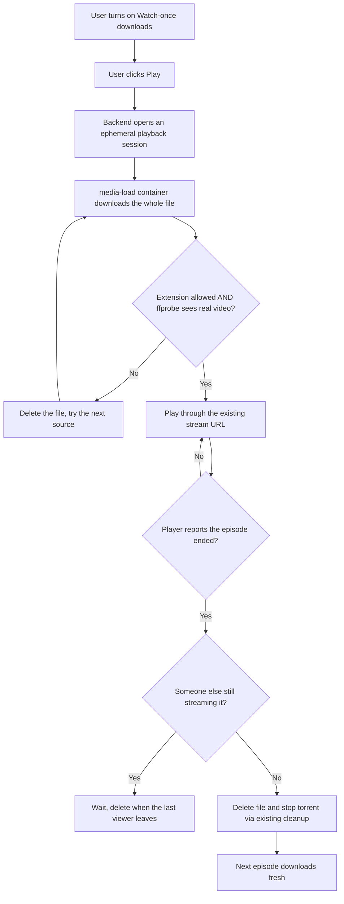

# Watch-once downloads plan

Status: Implemented (2026-11-28). See [Watching movies and episodes](../features/watching.md#watch-once-downloads) for the behavior and its limits.

## Goal

Optional mode where a torrent file is downloaded in full inside the existing Docker container, verified to be real media, played once, and deleted when playback finishes. Purpose: keep disk usage near zero on low-storage devices and avoid handing non-media files to the player.

## Terms

- **Watch-once mode** — the opt-in setting that enables this behavior. Off by default; current storage behavior is unchanged.
- **Media gate** — extension allowlist plus an ffprobe check that the completed file is a playable video. Runs before any bytes are served.
- **Delete trigger** — the player's "ended" event for the episode or movie.
- **Ephemeral claim** — a playback claim marked watch-once so it is not retained for watchlist preloading or seeding.

## Confirmed flow

## Decisions made with the user

1. Wait for the full download before playback; never stream partial bytes in watch-once mode.
2. Delete when playback finishes. Not on pause, not on player close.
3. Opt-in setting, not a global default.
4. Media gate: strict extension allowlist + ffprobe. No ClamAV / antivirus signatures.

## Deliberately out of scope

- A second Docker container or a different torrent client.
- Antivirus signature scanning.
- Deleting files while another viewer is streaming them.
- Streaming partial files in watch-once mode.
- Changing anything when the setting is off.
- Rewatching a title after its file has been deleted.

## Edge cases the implementation plan must resolve

- Where the setting lives (server-wide config vs per-user preference) and how the frontend reads it.
- How the backend learns the player reached the end, given the existing progress and next-episode countdown.
- Deferred deletion when `activeStreams > 0`, since the existing removal path refuses in that case.
- Multi-episode files: delete only after the last mapped episode ends.
- Failed media gate: clean up the rejected file and fall back to another source without leaving a broken playback session.
- No new dependencies unless ffprobe is unavailable in the container that must run the check.
